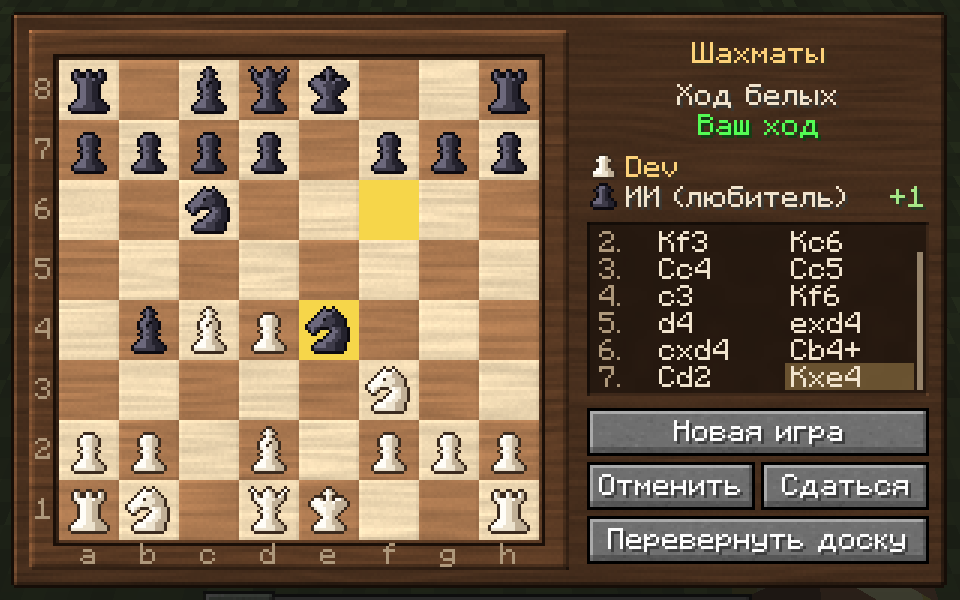
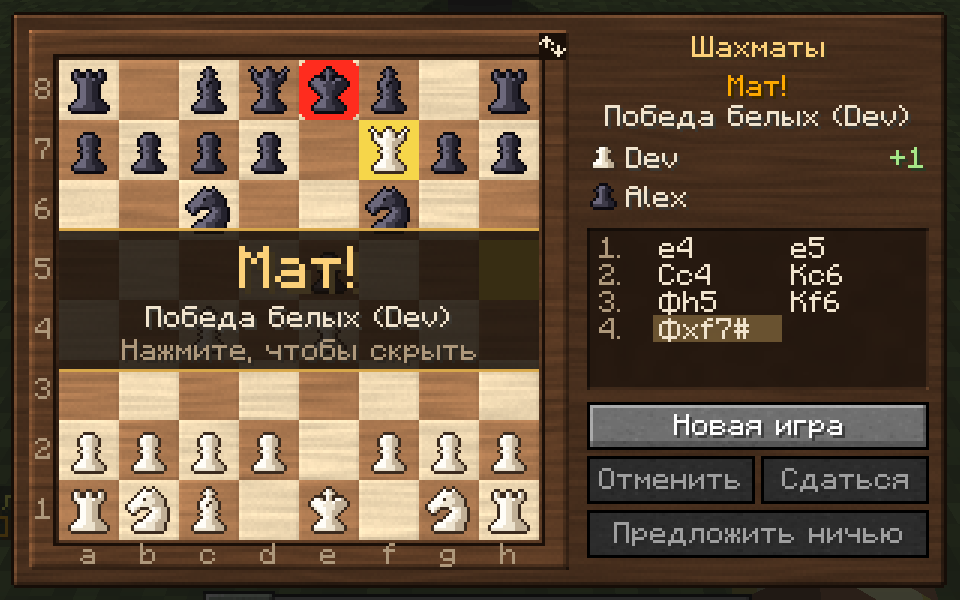
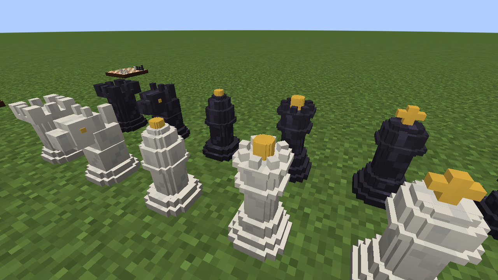
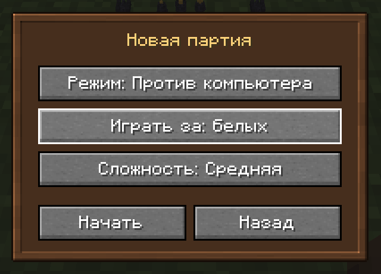
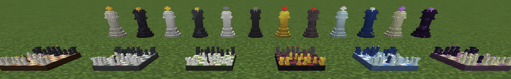
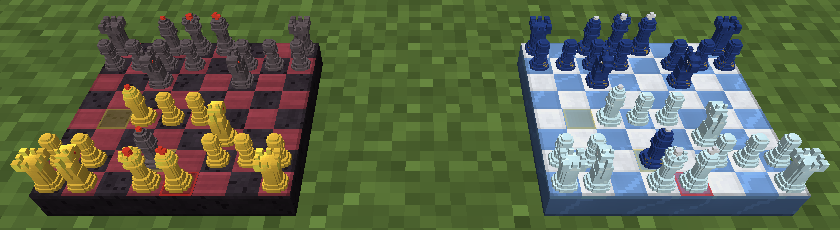
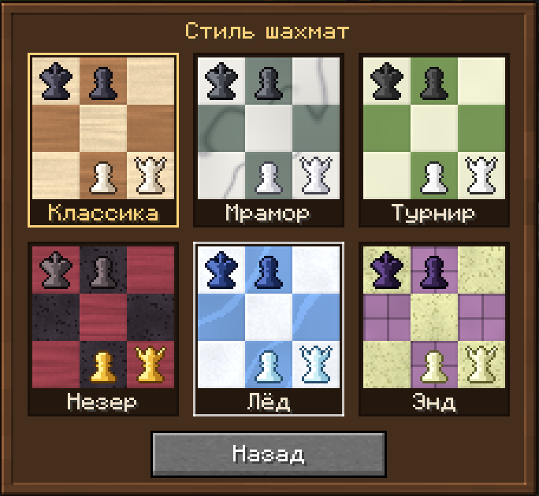

# Шахматы — мод для Minecraft Forge 1.20.1

Настоящие шахматы прямо в Minecraft: шахматная доска с объёмными анимированными фигурами,
полные правила игры, компьютерный соперник трёх уровней сложности и декоративные статуи фигур.

- **Minecraft** 1.20.1, **Forge** 47.4.28 (подходит любой Forge 47.x)
- **ID мода:** `chessmod`
- Работает в одиночной игре и на сервере (мод нужен и клиенту, и серверу)

| Доска в мире | Окно партии |
|--------------|-------------|
|  |  |
| **Мат и итог партии** | **Статуи фигур** |
|  |  |

## Возможности

### Шахматная доска
- Ставится как обычный блок; белые садятся с той стороны, где стоял игрок, поставивший доску.
- На доске видны все фигуры текущей партии в миниатюре: ходы анимированы (фигура плавно
  «перепрыгивает» на новую клетку), последний ход подсвечивается, король под шахом — красным.
- **ПКМ** по доске открывает окно партии:
  - текстурированная деревянная доска с координатами a–h / 1–8;
  - ходить можно щелчками (фигура → клетка) или перетаскиванием;
  - подсказки ходов: точки на свободных клетках, кольца на фигурах, которые можно взять;
  - выбор фигуры при превращении пешки;
  - история ходов в русской шахматной нотации (Кр, Ф, Л, С, К, 0-0), с прокруткой колёсиком;
  - имена игроков и материальный перевес (+3 и т. п.);
  - кнопки «Новая игра», «Отменить» (ход назад), «Сдаться» (с подтверждением), «Предложить ничью»
    и значок поворота доски в углу рамки;
  - баннер с итогом партии.
- Компаратор рядом с доской выдаёт сигнал 15, когда партия окончена.

### Режимы игры


- **Против игрока** — партия двух игроков на сервере или по локальной сети (LAN):
  1. Первый игрок открывает доску, нажимает «Новая игра», выбирает «Против игрока» и свой цвет.
  2. Второй игрок подходит к той же доске и нажимает «Сесть» напротив свободного места
     (или просто делает ход своими фигурами).
  3. Каждый видит доску со своей стороны, ходит только своими фигурами и только в свой ход.

  Даже если соперник отошёл от доски, он получит сообщение «Alex сыграл Кf3 — ваш ход» со звуковым сигналом.
  Отменить ход («Отменить») и согласиться на ничью («Предложить ничью») можно только с согласия
  соперника: у него появляется запрос с кнопками «Принять» и «Отказать». Начать новую партию,
  пока идёт чужая, посторонний игрок не может.
- **Против компьютера.** Выбор цвета (белые, чёрные, случайно) и уровня:
  - *Лёгкая* — «новичок», ошибается и не видит размены;
  - *Средняя* — «любитель», считает на несколько ходов вперёд;
  - *Сложная* — «мастер», думает до 2,5 секунд на ход (настраивается).

  Компьютер считает в отдельном потоке, поэтому сервер не подвисает. На предложение ничьей
  компьютер соглашается, только если его позиция заметно хуже.
- **За обе стороны** — один игрок ходит и белыми, и чёрными (разобрать партию, показать друзьям).

### Правила
Реализованы все правила шахмат: рокировка (в том числе запрет рокировки через битое поле),
взятие на проходе, превращение пешки в любую фигуру, шах, мат, пат, ничья по правилу 50 ходов,
по троекратному повторению позиции, при недостатке материала и по соглашению игроков. Правильность генерации ходов
проверяется perft-тестами на эталонных позициях.

### Стили


| Незер и Лёд вблизи | Выбор стиля |
|--------------------|-------------|
|  |  |

Шесть стилей меняют доску, объёмные фигуры и фигуры в окне партии:

| Стиль | Доска | Фигуры |
|-------|-------|--------|
| Классика | клён и орех | слоновая кость и эбеновое дерево, золотые украшения |
| Мрамор | белый и серо-зелёный мрамор | белый и чёрный мрамор |
| Турнир | кремовая и зелёная, как в шахматных клубах | простой белый и чёрный пластик |
| Незер | багровое дерево и чернокамень | золото против незерита, рубиновые украшения |
| Лёд | снег и голубой лёд | хрусталь против лазурита |
| Энд | эндерняк и пурпур | жемчуг против обсидиана, аметист |

- **Доска:** значок палитры в углу рамки открывает выбор стиля с превью. Стиль видят все игроки.
- **Статуи:** ПКМ пустой рукой переключает стиль.
- Сломанная доска или статуя сохраняет стиль в предмете — его видно на иконке и в подсказке.
  В творческой вкладке есть доска каждого стиля.

### Статуи фигур
12 декоративных блоков — белые и чёрные пешка, конь, слон, ладья, ферзь и король в рост блока.
Это те же модели, что стоят на доске, так что можно построить шахматы в натуральную величину.
Ставятся лицом к игроку, стиль меняется правым кликом пустой рукой.

### Рецепты
| Предмет | Как получить |
|---------|--------------|
| Шахматная доска | Верстак: `Б Т Б` / `Т Б Т` / `П П П`, где Б — берёзовые доски, Т — доски из тёмного дуба, П — любые деревянные плиты |
| Белые фигуры | Камнерез из кварцевого блока |
| Чёрные фигуры | Камнерез из полированного чернокамня |

Всё также есть в творческой вкладке «Шахматы».

### Настройки сервера
Файл `serverconfig/chessmod-server.toml` в папке мира:

| Параметр | По умолчанию | Описание |
|----------|--------------|----------|
| `hardThinkTimeMs` | 2500 | Сколько миллисекунд «мастер» думает над ходом |
| `computerMoveDelayTicks` | 12 | Пауза перед ответом компьютера (в тиках) |
| `announceResults` | true | Писать итог партии в чат игрокам поблизости |

## Сборка и запуск

Нужен **JDK 17** (если его нет, Gradle скачает сам). Первая сборка занимает несколько минут:
Gradle скачивает и декомпилирует Minecraft.

| Команда | Что делает |
|---------|-----------|
| `./gradlew build` | Собирает мод в `build/libs/chessmod-1.2.0.jar` и запускает тесты |
| `./gradlew test` | Только тесты шахматного движка |
| `./gradlew runClient` | Запускает Minecraft с модом |
| `./gradlew runServer` | Запускает выделенный сервер с модом |
| `./gradlew genIntellijRuns` | Создаёт конфигурации запуска для IntelliJ IDEA (`genEclipseRuns` — для Eclipse) |

На Windows вместо `./gradlew` используйте `gradlew.bat`.
Готовый `.jar` из `build/libs/` кладётся в папку `mods` клиента или сервера с Forge 1.20.1.

## Устройство проекта

```
src/main/java/io/github/nicksementsov/chessmod/
  ChessMod.java, ChessConfig.java   главный класс мода и настройки
  chess/        шахматный движок без зависимостей от Minecraft:
                позиция, генерация ходов, нотация, партия, компьютерный соперник
  board/        блок доски, блок-сущность с партией (места игроков, предложения ничьей и отмены,
                сохранение, синхронизация, ходы компьютера)
  piece/        блоки-статуи фигур
  network/      пакет «действие игрока» (ход, новая игра, сесть, отмена, ничья, сдача, стиль)
  style/        стили доски и фигур (свойство блока «style»)
  registry/     регистрация блоков, предметов, блок-сущностей и творческой вкладки
  client/       окно партии, окно новой игры, выбор стиля, отрисовка фигур на доске
src/main/resources/
  assets/chessmod/   текстуры, модели, состояния блоков, переводы (ru_ru, en_us)
  data/              рецепты, таблицы добычи, теги инструментов
src/test/java/       тесты движка (perft, правила, нотация, компьютер)
tools/generate_assets.py   генератор текстур, моделей, рецептов и таблиц добычи
```

### Текстуры и модели
Все текстуры (доски и материалы фигур шести стилей — дерево, мрамор, пластик, чернокамень,
лёд, пурпур, металлы; интерфейс; пиксель-арт фигур 16×16 для каждого стиля; логотип) и модели
фигур создаются скриптом. Новый стиль — это ещё одна запись в словаре `STYLES` скрипта
и значение в перечислении `ChessStyle`:

```bash
pip install pillow numpy
python3 tools/generate_assets.py
```

Скрипт перезаписывает файлы в `src/main/resources`, поэтому правки удобнее вносить в него.
Если хочется нарисовать текстуры вручную — просто редактируйте PNG и больше не запускайте скрипт.

## Полезные ссылки

- Документация Forge 1.20.1: https://docs.minecraftforge.net/en/1.20.1/gettingstarted/
- Загрузки Forge: https://files.minecraftforge.net/net/minecraftforge/forge/index_1.20.1.html
- Эталонные perft-значения: https://www.chessprogramming.org/Perft_Results
