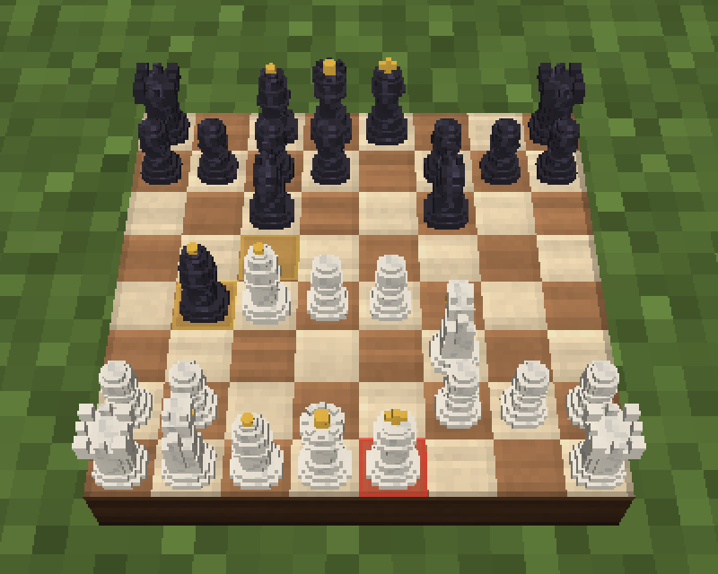
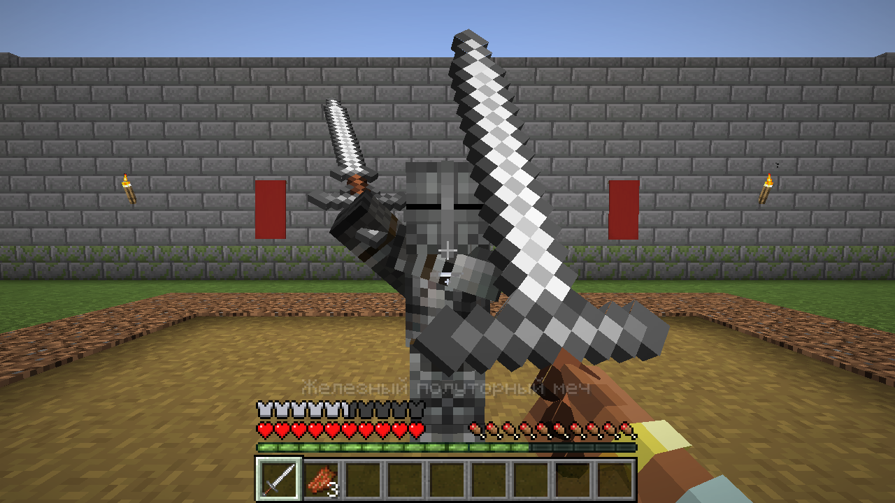

# Моды для Minecraft Forge 1.20.1

Каждый мод лежит в своей папке и собирается в свой `.jar`.

| Мод | Папка | Что это |
|-----|-------|---------|
| [Шахматы](chess/README.md) | `chess/` | Шахматная доска с объёмными фигурами, полные правила, компьютерный соперник, партии двух игроков, шесть стилей |
| [Рыцарский бой](knightcombat/README.md) | `knightcombat/` | Ближний бой в духе Chivalry 2: удары сбоку, сверху и уколы с замахом, тяжёлые удары, комбо с добивающими ударами, блок и парирование, щиты со своей анимацией, рипост, финты и отмены, пинок, уклонения, броски оружия, таран копьём на коне, выносливость, искры, кровь и пыль от ударов и записанные звуки боя; оружие Minecraft, Epic Knights и его аддонов (Addon, Slavic Armory, Antique Legacy, Dark Ages). По тем же правилам дерутся бойцы-NPC других модов |
| [Дружина](druzhina/README.md) | `druzhina/` | Своё войско: найм воинов у вербовочного стола, приказы жезлом воеводы (за мной, строй, в атаку), вид полководца, звания за победы, шайки разбойников. Воины дерутся по правилам «Рыцарского боя», как игрок |
| [Престол](prestol/README.md) | `prestol/` | Державы, войны и осады для MineColonies; войско держав — воины «Дружины», нанимать их можно, только если в колонии есть казарма (отдельный Gradle-проект, собирается после «Дружины» и «Рыцарского боя») |

| Шахматы | Рыцарский бой |
|---------|---------------|
|  |  |

## Сборка

Нужен **JDK 17** (если его нет, Gradle скачает сам). Первая сборка занимает несколько минут:
Gradle скачивает и декомпилирует Minecraft.

| Команда | Что делает |
|---------|-----------|
| `./gradlew build` | Собирает шахматы, «Рыцарский бой» и «Дружину» и запускает тесты |
| `./gradlew :chess:build` | Только шахматы → `chess/build/libs/chessmod-1.2.0.jar` |
| `./gradlew :knightcombat:build` | «Рыцарский бой» → `knightcombat/build/libs/knightcombat-2.10.0.jar` |
| `./gradlew :druzhina:build` | «Дружина» → `druzhina/build/libs/druzhina-1.2.0.jar` |
| `cd prestol && ./gradlew build` | «Престол» → `prestol/build/libs/prestol-2.1.0.jar` (сначала соберите «Дружину» и «Рыцарский бой») |
| `./gradlew :chess:runClient` | Minecraft с модом шахмат (`:knightcombat:runClient` — с боевым модом, `:druzhina:runClient` — с «Дружиной» и «Рыцарским боем») |
| `./gradlew :chess:runServer` | Выделенный сервер с модом (`:knightcombat:runServer`) |

На Windows вместо `./gradlew` используйте `gradlew.bat`. Готовый `.jar` кладётся в папку `mods`
клиента или сервера с Forge 1.20.1.

«Дружине» нужны «Рыцарский бой» и Epic Knights (с Architectury и Cloth Config); аддоны Epic Knights (Slavic Armory,
Addon) желательны. «Престолу» нужны «Дружина», MineColonies, Betsy Ross и Immersive Paintings.

## Устройство репозитория

```
settings.gradle       список модов (include 'chess', 'druzhina', 'knightcombat')
build.gradle          версия ForgeGradle для всех модов
gradle.properties     общие версии: Minecraft 1.20.1, Forge 47.4.28, маппинги
chess/                мод «Шахматы»: build.gradle, gradle.properties (id, имя, версия мода), src, tools, docs
knightcombat/         мод «Рыцарский бой»: так же
druzhina/             мод «Дружина»: так же
prestol/              мод «Престол»: отдельный Gradle-проект со своим gradlew
```

Новый мод — это ещё одна папка с `build.gradle`, `gradle.properties` и `src` (проще всего скопировать
папку одного из модов и поменять `mod_id`, пакет и имя) и строка `include '<папка>'` в `settings.gradle`.

## Полезные ссылки

- Документация Forge 1.20.1: https://docs.minecraftforge.net/en/1.20.1/gettingstarted/
- Загрузки Forge: https://files.minecraftforge.net/net/minecraftforge/forge/index_1.20.1.html
