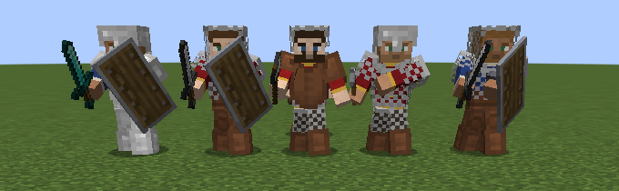

# Дружина — мод для Minecraft Forge 1.20.1

Своё войско, которое дерётся по-настоящему. Нанимайте мечников, копейщиков, секироносцев, лучников и витязей
у вербовочного стола, водите их жезлом воеводы и отбивайтесь от шаек разбойников, что бродят по земле.

Каждый воин сражается по правилам мода [Рыцарский бой](../knightcombat/README.md) — ровно так же, как игрок:
замахивается для удара сбоку, сверху или уколом, держит удар для тяжёлого, связывает удары в комбо, ставит блок
и поднимает щит, парирует и отвечает рипостом, обманывает финтом, ломает затянувшуюся защиту пинком или ударом
щита, а уставший — отходит за щит и переводит дух боевым кличем. Чем опытнее воин, тем точнее он читает удары
противника и тем чаще парирует.

| Дружина | Бой с шайкой разбойников |
|---------|--------------------------|
|  |  |
| **Строй по приказу «Стоять здесь!»** | **Вербовочный стол** |
|  |  |

- **Minecraft** 1.20.1, **Forge** 47.x
- **ID мода:** `druzhina`
- **Нужен мод** «Рыцарский бой» (`knightcombat`) версии 2.8.0 или новее — и на сервере, и у игроков.
- [Epic Knights](https://modrinth.com/mod/epic-knights-shields-armor-and-weapons) не обязателен: если он
  установлен, воины берут в руки его мечи, пики, секиры и щиты.

## Как играть

1. **Соберите вербовочный стол** (верхний ряд: бумага, изумруд, бумага; средний: бревно, железный меч, бревно; нижний: бревно, пусто, бревно)
   и поставьте его.
2. **Нажмите по столу ПКМ.** Откроется окно найма: кто служит, сколько стоит (в изумрудах), сколько у вас
   изумрудов и воинов. С первым нанятым воином вы получите **жезл воеводы**.
3. **Отдавайте приказы жезлом** (действует на ваших воинов в 64 блоках):

   | Действие | Приказ |
   |----------|--------|
   | ПКМ в воздух | **«За мной!»** — воины идут за вами и бьют того, кто напал на вас или на кого напали вы |
   | ПКМ по земле | **«Стоять здесь!»** — воины строятся в линию в этом месте лицом туда, куда смотрите вы: бойцы с клинками впереди, лучники во втором ряду |
   | Shift + ПКМ | **«В атаку!»** — воины бросаются на всех врагов вокруг |

4. **Снаряжайте воинов**: ПКМ по своему воину с оружием, щитом или доспехом в руке — он возьмёт вещь, а свою
   старую отдаст вам. Пустой рукой — он скажет, как он: здоровье, сколько врагов сразил, какой приказ выполняет.
   Shift + ПКМ пустой рукой два раза подряд — отпустить воина домой.
5. **Отбивайте шайки.** Время от времени на вас выходит шайка разбойников (на одинокого путника — двое, на войско — с атаманом) — о ней трубят дозорные,
   в чате видно, сколько их и с какой стороны идут. Чем больше ваше войско, тем больше шайка.
   С разбойников падают изумруды — на них можно нанять новых воинов.

## Воины

| Роль | Цена | Здоровье | Умение | Снаряжение |
|------|------|----------|--------|-----------|
| Мечник | 8 | 24 | 50% | меч и щит, кольчуга |
| Копейщик | 8 | 24 | 50% | копьё (длинная досягаемость), шлем и кольчуга |
| Секироносец | 8 | 26 | 45% | секира (рубит щиты), кольчужный шлем |
| Лучник | 10 | 20 | 45% | лук, кожаный доспех |
| Витязь | 28 | 32 | 75% | лучший меч и щит, железные латы |

**Звания.** Воин, переживший бои, растёт: за 3 сражённых врага он становится *Бывалым*, за 10 — *Ветераном*,
за 25 — *Богатырём*. С каждым званием у него больше здоровья (+2) и умения (+10%): он чаще парирует, быстрее
отвечает, связывает удары в комбо и обманывает финтами. Поэтому опытных воинов стоит беречь.

**Раны.** Вне боя воины понемногу залечивают раны. Если воин погиб, вещи, которые вы ему дали, остаются лежать
на земле.

**Свои своих не бьют.** Удары и стрелы воинов не задевают ни вас, ни ваших воинов: лучник стреляет из-за спин
товарищей, и стрела пролетает сквозь своих.

**Разбойники** — разбойник (топор или меч, иногда щит), разбойник-лучник и атаман (секира и кольчуга). Они
нападают на игроков, жителей и чужих воинов.

## Настройки

Файл `serverconfig/druzhina-server.toml` в папке мира:

| Настройка | По умолчанию | Что значит |
|-----------|--------------|-----------|
| `maxSoldiers` | 12 | Сколько воинов может быть у одного игрока |
| `priceMultiplier` | 1.0 | Множитель цен найма |
| `raids` | true | Ходят ли шайки разбойников |
| `firstRaidMinutes` | 15 | Минут игры до первой шайки |
| `raidMinutes` | 20 | Минут между шайками (в среднем) |
| `maxBand` | 10 | Наибольшая шайка |

## Команды

| Команда | Кто может | Что делает |
|---------|-----------|-----------|
| `/druzhina army` | все | Список ваших воинов: здоровье, сражённые враги, приказ |
| `/druzhina hire <роль> [число]` | операторы | Даёт воинов бесплатно (роль `bandit`, `bandit_archer`, `chieftain` — призывает разбойников) |
| `/druzhina raid` | операторы | Шайка разбойников идёт на вас прямо сейчас |

## Сборка

| Команда | Что делает |
|---------|-----------|
| `./gradlew :druzhina:build` | Собирает мод в `druzhina/build/libs/druzhina-1.0.0.jar` |
| `./gradlew :druzhina:runClient` | Запускает Minecraft с «Дружиной» и «Рыцарским боем» |

## Устройство проекта

```
src/main/java/io/github/nicksementsov/druzhina/
  Druzhina.java, DruzhinaConfig.java   главный класс мода и настройки
  entity/        воин (Soldier): роли, звания, приказы, союзники, снаряжение, сохранение
  entity/ai/     поведение: поединок по правилам Рыцарского боя (DuelGoal), стрельба из лука, строй,
                 следование за воеводой, защита воеводы
  server/        найм и приказы (Army), шайки разбойников (Bandits), команды, события
  item/, block/  жезл воеводы, копьё, вербовочный стол
  network/       пакет найма
  client/        отрисовка воинов (модель игрока, доспехи, оружие Рыцарского боя), окно найма
src/main/resources/
  assets/druzhina/   скины воинов и разбойников, текстуры, модели, переводы (ru_ru, en_us)
  data/              рецепты, добыча со стола
```
