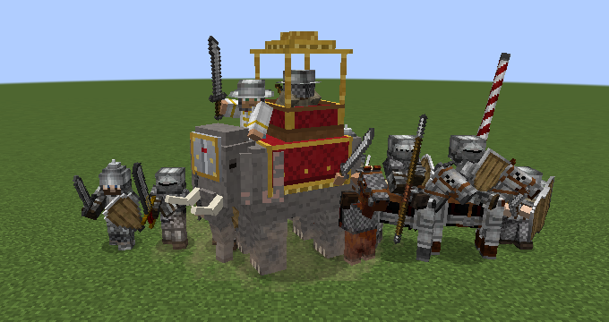
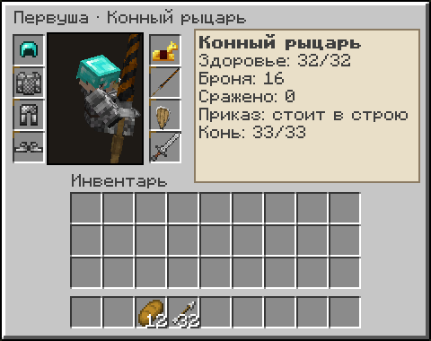
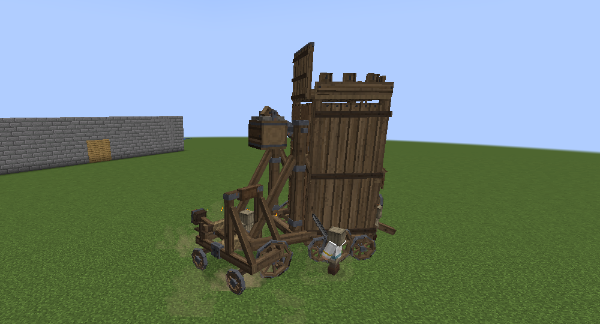
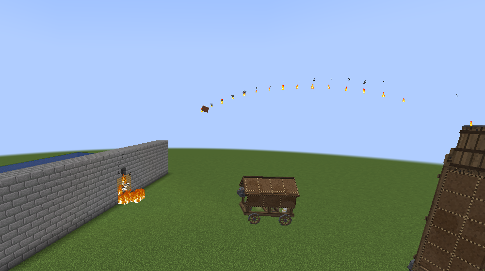
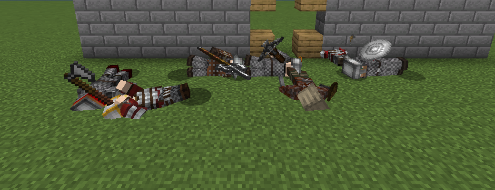
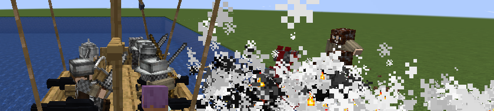
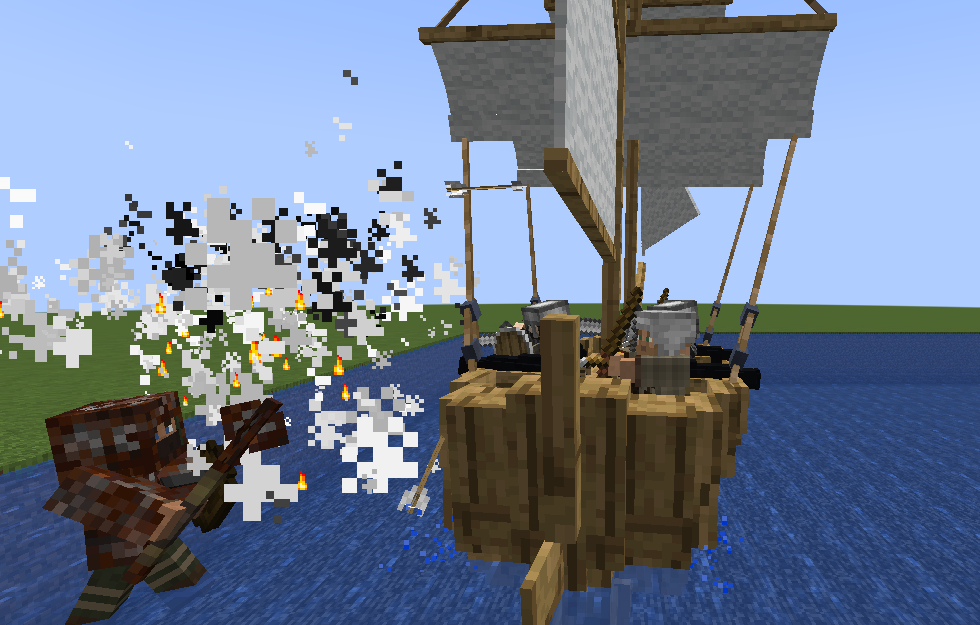

# Дружина — мод для Minecraft Forge 1.20.1

Своё войско, которое дерётся по-настоящему. Нанимайте у вербовочного стола пехоту (мечников, копейщиков,
щитоносцев, секироносцев, булавников, ратников), дружину и рыцарей (дружинников, витязей, рыцарей в латах), стрелков,
конницу (всадников, конных рыцарей с копьями, конных лучников), боевых слонов и осадные орудия (требушет, мангонель,
баллисту, бомбарду, таран, осадную башню, гуляй-город); водите их жезлом воеводы,
снаряжайте своими вещами и отбивайтесь от шаек разбойников, что бродят по земле. Всё оружие и доспехи воинов — из Epic Knights и его аддонов. Вместе с модом «Престол» воины «Дружины»
становятся войском держав MineColonies.

Каждый воин сражается по правилам мода [Рыцарский бой](../knightcombat/README.md) — ровно так же, как игрок:
замахивается для удара сбоку, сверху или уколом, держит удар для тяжёлого, связывает удары в комбо, ставит блок
и поднимает щит, парирует и отвечает рипостом, обманывает финтом, ломает затянувшуюся защиту пинком или ударом
щита, а уставший — отходит за щит и переводит дух боевым кличем. Чем опытнее воин, тем точнее он читает удары
противника и тем чаще парирует.

| Дружина в снаряжении Epic Knights | Бой с шайкой разбойников |
|------------------------------------|--------------------------|
|  |  |

| Вид полководца (F4) |
|--------------------|
|  |

| Конница и боевой слон | Снаряжение воина |
|-----------------------|------------------|
|  |  |


- **Minecraft** 1.20.1, **Forge** 47.x
- **ID мода:** `druzhina`
- **Нужны моды** (и на сервере, и у игроков):
  - «Рыцарский бой» (`knightcombat`) 2.11.0 или новее;
  - [Epic Knights](https://modrinth.com/mod/epic-knights-shields-armor-and-weapons) (`magistuarmory`) — всё оружие
    и все доспехи воинов из него; ему самому нужны Architectury и Cloth Config.
- **Желательны аддоны Epic Knights**: [Epic Knights: Slavic Armory](https://modrinth.com/mod/epic-knights-slavic-armory)
  (русские мечи, топоры, рогатины, кольчуги, шлемы — дружина начинает выглядеть как дружина) и
  [Epic Knights: Addon](https://modrinth.com/mod/epic-knights-addon) (ещё десятки мечей, секир, копий и шлемов).
  Если аддон стоит, его вещи сами попадают в снаряжение воинов.
- С [Small Ships](https://modrinth.com/mod/small-ships) воины плавают с вами на кораблях: садятся на корабль вслед
  за вами, стреляют с борта, становятся к пушкам и сходят на берег за вами (см. «Корабли» ниже). Сам мод
  «Дружине» не нужен: если его нет, то же работает с лодками и плотами Minecraft.
- Со «Престолом» (`prestol`) воины «Дружины» становятся войском держав MineColonies: гарнизонами башен, ополчением
  и наёмниками. Тогда нанимать воинов у вербовочного стола можно, только если в вашей колонии (или в колонии вашей
  державы) построена казарма, а сколько воинов водить — зависит от развития державы. Когда держава воюет с другой
  (после мобилизации), её воины сами нападают на всех, кто воюет за врага: на его воинов и гарнизоны, его правителя и
  наместников, стражу его колоний; на союзников не нападают. В виде полководца враги обведены красным.

## Как играть

1. **Соберите вербовочный стол** (верхний ряд: бумага, изумруд, бумага; средний: бревно, железный меч, бревно; нижний: бревно, пусто, бревно)
   и поставьте его.
2. **Нажмите по столу ПКМ.** Откроется окно найма с вкладками «Пехота», «Дружина», «Стрелки», «Конница», «Слоны», «Осада»:
   кто служит, сколько стоит (в золотых слитках), сколько у вас золота и воинов. Платят слитками из сумки (подходят и золотые слитки других модов). С первым нанятым воином вы получите **жезл воеводы**.
   Нанимать можно сколько угодно воинов — лишь бы хватило золота (сервер может задать предел настройкой `armyLimit`).
   С модом «Престол» предел задаёт развитие державы: жители её поселений, казармы и башни, ранг державы — сколько
   воинов вам можно водить и почему, показано вверху окна найма (наведите мышь на «Дружина: … / …»).
3. **Отдавайте приказы жезлом** (действует на ваших воинов в 64 блоках):

   | Действие | Приказ |
   |----------|--------|
   | ПКМ в воздух | **«За мной!»** — воины идут за вами и бьют того, кто напал на вас или на кого напали вы |
   | ПКМ по земле | **«Стоять здесь!»** — воины строятся в линию в этом месте лицом туда, куда смотрите вы: бойцы с клинками впереди, лучники во втором ряду |
   | Shift + ПКМ | **«В атаку!»** — воины бросаются на всех врагов вокруг |

4. **Вид полководца (клавиша F4)** — режим RTS в духе Hundred Years Warfare: камера отрывается от вас и свободно
   летает над полем, вы остаётесь стоять на месте, а воинами управляете мышью и клавишами. Внизу — панель: карточки
   отрядов по ролям (оружие, сколько выбрано, общее здоровье), кнопки приказов и строёв; над ней — ваши группы.

   | Действие | Что делает |
   |----------|-----------|
   | ЛКМ по воину | выбрать его (Shift — добавить/убрать, двойной клик — всех этой роли на экране, Ctrl — всех этой роли) |
   | ЛКМ, протянуть рамку | выбрать всех в рамке; Ctrl+A или кнопка «Все» — всех ваших воинов |
   | ЛКМ по карточке внизу | выбрать всех воинов этой роли (Shift — добавить/убрать, ПКМ — убрать из выбранных, двойной клик — камера к ним) |
   | Ctrl+1…9 / 1…9 | запомнить выбранных как группу / выбрать группу (дважды — камера к ней, Shift — добавить к выбранным) |
   | ПКМ по земле | идти туда строем и построиться лицом от того места, откуда идут |
   | ПКМ, протянуть по земле | протянутая линия — фронт строя: его ширина и направление; пока тянете, видны места каждого |
   | Shift + ПКМ | следующая точка пути — в очередь после уже отданных (на земле путь с номерами точек) |
   | Ctrl + ПКМ (или R, затем ПКМ) | идти с боем: бить всех врагов, встреченных по пути, затем построиться |
   | Alt + ПКМ (или P, затем ПКМ) | дозор: ходить отсюда туда и обратно (с Shift — ещё точка дозора) |
   | ПКМ по врагу | напасть на него всем отрядом; после боя воины стоят там, где он кончился |
   | ПКМ по кораблю | сесть на корабль |
   | G (или кнопка «Обстрел»), затем ПКМ по стене | осадные орудия из выбранных бьют в это место: требушеты и баллисты — с дальности выстрела (кто не достаёт — подъезжает), тараны подъезжают вплотную; на земле — оранжевый крест цели |
   | H / F / C | стоять на месте / за мной / натиск (бить всех вокруг) |
   | B | сомкнуть строй: пешие бьются только на своём месте и не гонятся за врагом (ещё раз — биться вольно) |
   | Z (Shift+Z) | следующий (предыдущий) строй: линия, колонна, клин, каре, россыпь |
   | WASD или стрелки, мышь у края экрана | двигать камеру (с Shift — быстрее); Q/E или зажатое колесо — поворот и наклон; колесо — ближе/дальше |
   | Tab | камера к выбранным (если никого не выбрано — к вам) |
   | ? (/) | все клавиши на экране |
   | F4 или Esc | вернуться в обычный вид |

   **Как ходят строем.** По приказу «идти» отряд сперва строится там, где стоит, затем идёт в ногу, держа свои места
   в рядах, со скоростью самого медленного (всадники не убегают от пехоты, слон задаёт шаг всем), ждёт отставших и
   обходит препятствия (кто не пройдёт — догоняет своей дорогой), а на месте встаёт в выбранный строй. Бойцы с клинками
   стоят впереди, стрелки — за ними, всадники — отдельными рядами позади пеших, с бо́льшими промежутками. На простом
   марше воины не отвлекаются на врагов, только отвечают тому, кто на них напал; «с боем» — бьют всех встречных и
   идут дальше, когда враги кончатся.

   На земле видно: зелёные кольца — выбранные воины, зелёные линии — куда идёт каждый из них, жёлтые линии со
   стрелками и номерами — путь отряда по очереди точек. Над выбранными — полоска здоровья, номер группы и синяя
   черта, если воин держит строй. Камера уходит от вас не дальше 112 блоков. Клавишу F4 можно сменить в настройках
   управления (раздел «Дружина»).

5. **Снаряжайте воинов.** ПКМ по своему воину пустой рукой — откроется его окно: шлем, доспех, поножи, сапоги,
   правая рука (оружие), левая (щит), запасное оружие и, если он на коне, броня коня; рядом — звание, здоровье,
   броня, сколько врагов сразил, какой приказ выполняет, здоровье коня или слона.
   - Перетащите вещь из своего инвентаря в ячейку (или Shift + клик по вещи — она сама встанет куда надо).
     Воин может держать в руках что угодно: дадите лук — станет стрелять, меч — рубиться, копьё на коне — бить с разгона.
   - **Своё снаряжение** воина (с золотым уголком) забрать нельзя — иначе воин за 20 слитков давал бы полный доспех.
     Но поверх него можно положить своё: воин отложит своё и возьмёт его снова, когда вы заберёте выданное.
   - **Выданное вами** можно забрать обратно; если воин погиб — оно остаётся лежать на земле.
   - Быстро: ПКМ по воину с оружием, щитом или доспехом в руке — он сразу возьмёт вещь.
   - Shift + ПКМ пустой рукой два раза подряд — отпустить воина домой (вместе с его конём).
6. **Отбивайте шайки.** Время от времени на вас выходит шайка разбойников (на одинокого путника — двое, на войско — с атаманом) — о ней трубят дозорные,
   в чате видно, сколько их и с какой стороны идут. Чем больше ваше войско, тем больше шайка.
   С разбойников падают золотые слитки — на них можно нанять новых воинов.

## Воины

Всё снаряжение — из Epic Knights и аддонов, каждый раз немного разное: какой меч, какой шлем, какая кольчуга —
выбирается из подходящих. Вербовочный стол повёрнут к **Западу** или к **Востоку** (переключатель вверху окна):
западные воины носят доспехи и оружие латинских королевств — кольчугу и латы, треугольные щиты, армирующие мечи,
алебарды, длинные луки и арбалеты; восточные — Руси, Византии, сарацин и степи: чешую и ламелляр, круглые щиты,
сабли, бердыши и рогатины. Восточные вещи берутся из Epic Knights: Addon (сарацины, мамлюки, половцы), Slavic Armory
(Русь, Византия) и Dark Ages (степь, варяги); если аддона нет, воин получает похожее из самого Epic Knights. И имена
у них свои: западные (Генрих, Ричард, Гуго), русские (Добрыня, Ратибор), сарацинские и половецкие (Юсуф, Бейбарс,
Кончак), греческие у византийцев (Никифор, Варда), норманнские у варягов (Харальд, Ингвар).

### Запад

| Вкладка | Роль | Цена | Здоровье | Умение | Снаряжение |
|---------|------|------|----------|--------|-----------|
| Пехота | Мечник | 20 | 24 | 50% | армирующий меч или катцбальгер и треугольный щит, кольчуга, шапель или норманнский шлем |
| | Копейщик | 20 | 24 | 50% | пика, ранзеур, гизарма или кабанье копьё — бьёт издалека, кольчуга |
| | Щитоносец | 25 | 26 | 50% | павеза или скутум и короткое копьё — стена, за которой стоят стрелки |
| | Секироносец | 22 | 26 | 45% | лохаберская, датская или галлоглассская секира — рубят щиты |
| | Булавник | 25 | 26 | 45% | булава или боевой молот и щит — латы ему не помеха |
| | Ратник | 22 | 26 | 45% | двуручный меч (бастард, клеймор, цвайхендер, длинный меч), кольчуга |
| | Алебардщик | 24 | 26 | 50% | швейцарская или французская алебарда, глефа, гусарка, билль; бригантина и морион |
| Рыцари | Рыцарь | 70 | 32 | 75% | латы и топфхельм; рыцарский меч и щит или полэкс в обе руки |
| | Крестоносец | 65 | 32 | 70% | топфхельм, крестоносная котта поверх кольчуги, рыцарский меч и треугольный щит |
| Стрелки | Лучник | 24 | 20 | 45% | длинный лук, стёганка, шапель |
| | Арбалетчик | 30 | 22 | 45% | тяжёлый арбалет — медленный, но болт пробивает доспех, кольчуга |
| Конница | Конный сержант | 55 | 26 | 55% | меч и треугольный щит, кольчуга, шапель; конь в кольчужной попоне |
| | Конный рыцарь | 100 | 32 | 70% | рыцарское копьё и щит, латы, меч на поясе; конь в бардах |

### Восток

| Вкладка | Роль | Цена | Здоровье | Умение | Снаряжение |
|---------|------|------|----------|--------|-----------|
| Пехота | Сарацин | 22 | 24 | 55% | скимитар или сабля и круглый щит, сарацинский шлем и доспех |
| | Скутат | 25 | 26 | 50% | византийский пехотинец: копьё и миндалевидный щит, чешуя или ламелляр |
| | Бердышник | 22 | 26 | 45% | бердыш, куяк или кафтан, восточная шапель |
| | Рогатинщик | 20 | 24 | 50% | рогатина в обе руки, кольчуга Руси, шишак |
| Дружина | Дружинник | 36 | 28 | 60% | русский меч или топор и круглый щит, кольчуга или чешуя Руси, русский шлем |
| | Витязь | 75 | 32 | 75% | юшман или бехтерец, русский меч и щит, шлем-шишак |
| | Варяг | 45 | 30 | 65% | варяжская стража Византии: датская или византийская секира, ламелляр, варяжский шлем |
| Стрелки | Степной лучник | 24 | 20 | 50% | короткий лук, кафтан, меховая шапка или лёгкий половецкий шлем |
| | Самострельщик | 30 | 22 | 45% | самострел (тяжёлый арбалет), куяк или чешуя Руси |
| Конница | Всадник | 60 | 26 | 55% | конный дружинник: русский меч или сабля и щит, кольчуга; конь в кольчужной попоне |
| | Катафракт | 110 | 34 | 70% | тяжёлый ламелляр, копьё в сшибку и щит, сабля у пояса; конь в бардах |
| | Мамлюк | 65 | 28 | 65% | шлем мамлюка, сарацинский доспех, кавалерийская сабля и круглый щит; конь в кольчуге |
| | Конный лучник | 55 | 22 | 50% | степняк: короткий лук, кафтан или ламелляр «балык-сук»; конь в кожаной попоне |
| Слоны | Боевой слон | 160 | слон 160 | — | слон в попоне и налобнике, погонщик и степной лучник в башенке (двое воинов) |
| Осада | Требушет | 200 | орудие 140 | — | требушет на колёсах и метальщик при нём (одинаков у Запада и Востока) |
| | Баллиста | 90 | орудие 70 | — | баллиста на тележке и баллистарий |
| | Таран | 120 | орудие 180 | — | крытый таран под сырыми шкурами и таранщик |
| | Мангонель | 110 | орудие 90 | — | мангонель с огненными горшками и пороковщик |
| | Бомбарда | 260 | орудие 100 | — | бомбарда на колёсном лафете и пушкарь |
| | Осадная башня | 150 | орудие 220 | — | башня на колёсах с откидным мостом и осадник |
| | Гуляй-город | 40 | орудие 110 | — | щит из досок с бойницами на колёсах и щитоносец |

Цены — в золотых слитках. Если ролей во вкладке больше, чем помещается на экране, список прокручивается колесом мыши.

## Конница и слоны

**Всадник** приходит со своим конём (осёдланным, в броне, приручённым вами). Конь — его ноги: всадник ведёт коня
по пути, за воеводой, в строй и в бой. Мечом всадник рубит с седла, разворачивая коня так, чтобы враг был по правую
руку.

**Конный рыцарь** бьёт копьём по правилам «Рыцарского боя»: отъезжает, чтобы разогнаться, опускает копьё под руку
шагов за пятнадцать до врага, держит его на противнике, пока конь несёт копьё в цель (сила удара — скорость коня),
проносится мимо, разворачивается и заходит снова. Удар копьём может вышибить всадника из седла. Если конь убит,
рыцарь берёт с пояса меч и бьётся пешим; если конь жив — снова садится на него.

**Конный лучник** кружит вокруг врага на расстоянии выстрела и стреляет на скаку, не подпуская к себе.

**Пеший всадник** (сброшенный с седла или слезший) сам возвращается к своему коню или слону и садится на него, если
рядом нет врага.

**Боевой слон** — индийский слон с морщинистой серо-бурой кожей, массивными ногами-столбами, хоботом из пяти подвижных частей и изогнутыми бивнями в золотых кольцах; на нём тёмно-красная попона с бахромой и золотой каймой, стальная маска с шипом и башенка тёмного дерева с балясинами и балдахином.
На шее сидит погонщик и ведёт слона на врага; слон топчет тех, кто попал под ноги, и поднимает людей на бивни
(удар отбрасывает и может выбить всадника из седла). Из башенки стреляет лучник — поверх головы погонщика, в своих
не попадает. У слона 160 здоровья и толстая шкура, свои стрелы и удары его не ранят; вне боя он залечивает раны,
а сеном, пшеницей, яблоками или листьями его можно лечить. Без погонщика на слона можно сесть самому (ПКМ пустой
рукой): W/S — вперёд и назад, слон поворачивает за взглядом, Shift — слезть. Дикого слона (из яйца призыва)
можно приручить сеном.

Голос слона — запись трубящего азиатского слона (CC0), см. `src/main/resources/assets/druzhina/sounds/credits.txt`.

Есть ещё ополченец (вилы или дубина, стёганка) — его созывает «Престол», когда на поселение нападают.

**Звания.** Воин, переживший бои, растёт: за 3 сражённых врага он становится *Бывалым*, за 10 — *Ветераном*,
за 25 — *Богатырём*. С каждым званием у него больше здоровья (+2) и умения (+10%): он чаще парирует, быстрее
отвечает, связывает удары в комбо и обманывает финтами. Поэтому опытных воинов стоит беречь.

**Раны.** Вне боя воины понемногу залечивают раны. Если воин погиб, вещи, которые вы ему дали, остаются лежать
на земле.

**Свои своих не бьют.** Удары и стрелы воинов не задевают ни вас, ни ваших воинов: лучник стреляет из-за спин
товарищей, и стрела пролетает сквозь своих.

**Разбойники** — разбойник (ржавый меч, булава или дубина, ржавая кольчуга, иногда деревянный щит), разбойник-лучник
и атаман (моргенштерн или ржавый бастард, ржавые крестоносные доспехи и большой шлем). Они
нападают на игроков, жителей и чужих воинов.

## Осадные орудия





Орудие нанимают на вкладке «Осада» вместе с воином, который его двигает и работает на нём (он стоит у орудия; если
орудие разбито — берёт короткий клинок и бьётся пешим). Орудие ведут как любого воина: жезлом, `/druzhina order`, в
виде полководца — строем, по пути, за вами. Своих стрелы и удары не ранят; доски (ПКМ ими) чинят орудие на 10.

| Орудие | Бьёт | Дальность | Перезарядка | Здоровье, броня |
|--------|------|-----------|-------------|-----------------|
| **Требушет** | камнем навесом, через стены: давит людей вокруг места падения (до 24 урона, радиус 2,6) и трескает кладку | 12–64 | 10 с | 140, 8 |
| **Баллиста** | тяжёлым болтом почти прямой наводкой, только то, что видит; болт пробивает двух-трёх в ряд | 3–48 | 3 с | 70, 6 |
| **Таран** | бревном с железной головой в то, что прямо перед ним (ворота, стену), и сшибает стоящих впереди | вплотную | 2,5 с | 180, 14; стрелы почти не берут, огонь не берёт |
| **Мангонель** | горшком с горящей смолой: люди вокруг вспыхивают, загорается всё, что горит (если орудиям можно ломать) | 10–44 | 5 с | 90, 6 |
| **Бомбарда** | ядром почти прямой наводкой, по тому, что видит, с грохотом, вспышкой и дымом; ломает стены сильнее всех | 6–56 | 20 с | 100, 10 |
| **Осадная башня** | ничем: по приказу «Обстрел» подъезжает к стене, опускает мост, и ваши воины у её подножия (в 10 блоках) по одному перелезают на стену и бросаются в бой | вплотную | 0,8 с на воина | 220, 12; стрелы и огонь почти не берут |
| **Гуляй-город** | ничем: принимает на себя стрелы и болты, летящие в тех, кто за ним | — | — | 110, 8; стрелы берут вдвое слабее |

**Само по себе** орудие бьёт врагов в досягаемости: того, на кого напал его воин, или ближайшего. **По приказу
«Обстрел»** (вид полководца, G и ПКМ по стене) орудие бьёт выбранное место, пока не дадите другой приказ.

**Стены.** Каждый удар оставляет на блоке трещины (как при копании); блок, треснувший насквозь, рушится. Твёрдые блоки
держатся дольше: дубовые ворота таран выбивает ударов за 5, каменный кирпич требушет пробивает за 2–3 попадания рядом.
Не берут орудия блоки твёрже `maxHardness` (по умолчанию 10: обсидиан, незерит), неразрушимые и блоки с содержимым
(сундуки, печи, хижины колоний). Где мобам нельзя ломать блоки (`mobGriefing false`) или если `breakBlocks = false`,
орудия бьют только людей. Трещины забываются через две минуты без ударов.

**Свои орудия.** Требушет, баллисту и таран можно и собрать (рецепты ниже) — поставленное орудие ваше, но без
воина: Shift + ПКМ по нему пустой рукой — ближайший ваш свободный пеший воин подойдёт и встанет к орудию. Так же
можно поставить к орудию нового воина, если прежний пал.

| Орудие | Рецепт (сверху вниз) |
|--------|----------------------|
| Требушет | бревно, нить, бревно · булыжник, железный блок, булыжник · доски, сундук, доски |
| Баллиста | нить, арбалет, нить · железный слиток, доски, железный слиток · бревно, пусто, бревно |
| Таран | кожа ×3 · железный блок, бревно, железный блок · доски, пусто, доски |
| Мангонель | бревно, пусто, котёл · нить, бревно, нить · доски, железный слиток, доски |
| Бомбарда | железный блок ×3 · порох, динамит, железный блок · бревно, пусто, бревно |
| Осадная башня | доски, кожа, доски · бревно, лестница, бревно · бревно, железный слиток, бревно |
| Гуляй-город | доски ×3 · доски, железный слиток, доски · палка, пусто, палка |

## Павшие



Убитые не исчезают сразу и не валятся набок, как обычно в Minecraft: у воина сперва подгибаются колени, он
оседает, а потом валится ничком, навзничь или на бок (у каждого по-своему), всё быстрее, разворачиваясь корпусом;
руки разлетаются, тело чуть подскакивает о землю и замирает. Конь и слон заваливаются на бок.

**Отсечённое.** Смертельный удар секирой, мечом или древковым оружием может отсечь голову, руку или ногу
(тяжёлым — чаще), камень требушета, ядро или взрыв — оторвать одну-три части. Отсечённое отлетает, кувыркаясь,
и ложится рядом с телом, из ран брызжет кровь; оружие из отрубленной руки не висит в воздухе. Булава и стрелы
ничего не отсекают. На поле боя тело лежит **3–5 минут** (каждое чуть дольше
или короче, настройка `corpseSeconds`), в последние две секунды уходит в землю и рассеивается пылью. Лежат так
воины и разбойники, боевые слоны, кони всадников и все, кого убили воины (или вы, когда рядом ваше войско), кроме
боссов и жителей колоний MineColonies (колония сама ведёт счёт живым и павшим).
Мёртвого нельзя ни ударить, ни выбрать — он не мешает целиться и щёлкать по земле, над ним нет имени.

## Корабли (Small Ships)



С модом [Small Ships](https://modrinth.com/mod/small-ships) (проверено с 2.0.2; бета-версии 2.0.0-b1.x тоже
работают, но без пушек и без подсчёта мест) воины ходят с вами в море. То же работает с лодками и плотами Minecraft:
в лодке два места, одно из них ваше.

- **Посадка.** Сядьте на корабль (ПКМ по нему). Воины с приказом «За мной!» или «В атаку!», которые стоят не дальше
  24 блоков, подходят к борту (хватит и пары шагов по воде у причала) и садятся на свободные места. Идут столько,
  сколько мест. Всадник оставляет коня на берегу, слоны в море не ходят.
  Если мест не хватило, вы увидите «На корабле нет мест», и остальные будут ждать на берегу. За кораблём вплавь
  воины не бросаются.
- **На борту.** Воины сидят там, где их посадил Small Ships, и плывут с кораблём. Лучники и арбалетчики стреляют
  с борта, через своих и через свои корабли не стреляют. Бойцы с клинками рубят того, кто подошёл к борту на длину
  клинка. Свои стрелы и удары кораблю не вредят: Small Ships считает воинов командой.
- **Пушки** (Small Ships 2.0 и новее). Если на корабле есть пушки и места канониров, воин без лука садится к пушке.
  Он стреляет, когда враг оказывается с его борта в пределах выстрела (6–56 блоков) и на линии огня нет своих.
  Ядра берутся из трюма корабля. Если у штурвала сидите вы, прицел держите вы, а канониры только выбирают момент
  выстрела. Если за штурвалом никого нет, канониры сами ставят прицел под дальность.
- **Высадка.** Сойдите на берег, и воины с приказом «За мной!» или «В атаку!» сойдут следом и окажутся рядом с вами.
  Воины с приказом «Стоять!» остаются на корабле и охраняют его. Позже их можно позвать жезлом, приказав «За мной!».
  Конный рыцарь без коня берёт меч с пояса, а всадник садится на коня, если сошёл на берег не дальше 32 блоков от него.
- Small Ships уводит на берег мобов с палубы стоящего корабля, но ваших воинов не трогает: им выставлен его тег
  `smallships.stay_on_deck`.

### Воины сами ведут корабль (Small Ships 2.0 и новее)



- **Посадить команду.** ПКМ жезлом по кораблю: ваши воины в 64 блоках, не сидящие на другом судне, идут на этот
  корабль. Первый севший встаёт к штурвалу, вы увидите «… встаёт к штурвалу». Остальные занимают места на палубе
  и у пушек. Воинов можно посадить и в виде полководца (F4): выберите их и щёлкните ПКМ по кораблю. Посаженные так
  воины остаются на борту («Стоять!»).
- **Задать курс.** Сядьте на этот корабль: штурвал занят, поэтому вы сядете пассажиром. Посмотрите туда, куда
  плыть, и нажмите ПКМ жезлом в воздух: рулевой ведёт корабль к воде или берегу, на которые вы смотрите (до
  160 блоков), а если вы смотрите в небо, то на 96 блоков в ту сторону. В виде полководца то же делает ПКМ по
  воде. Приказ «Стоять!» (H) — корабль ложится в дрейф там, где он сейчас.
- **«За мной!»** (жезл с суши или F в виде полководца):
  - если вы на другом корабле, рулевой идёт следом за ним;
  - если вы на берегу, он подводит корабль к берегу рядом с вами, и вся команда, рулевой тоже, сходит к вам;
  - если вы на его корабле, он ждёт курса.
- **«В атаку!»** (Shift + ПКМ жезлом или C): рулевой идёт на ближайшего врага в 64 блоках. Если на корабле есть
  пушки, он разворачивается к врагу бортом с пушками на расстоянии около 20 блоков и держит его на траверзе, а
  канониры дают залпы. Без пушек корабль подходит к врагу на 7 блоков, и бьют лучники. Команда корабля в атаке
  остаётся на борту, даже если вы стоите рядом на берегу.
- **Как он правит.** Рулевой ставит и убирает паруса (чем дальше цель, тем больше парусов), на вёслах гребёт и
  перекладывает руль заранее, чтобы не проскочить курс. Берег и мели он обходит, глядя вперёд на длину корабля и
  ещё на несколько блоков. Если корабль сел на мель или упёрся в берег, он даёт задний ход и отворачивает. Если
  цель на суше, он подходит к ней так близко, как позволяет вода, и останавливается.
- Корабль, которым правит не игрок, подбирает (как лодка Minecraft) любое существо, которого коснётся. Рулевой
  сразу выбрасывает чужих (врагов и бродячих животных) за борт, в воду рядом с кораблём, с той стороны, где они
  сидели. Ваши воины, ваши животные, союзники и игроки остаются на борту.
- Small Ships разрешает стоять у штурвала только игрокам и сущностям из своей настройки `driverEntities`. Пока
  идёт игра, «Дружина» добавляет туда своих воинов (файл настроек при этом не меняется).
- Если у штурвала уже стоит воин, сами вы его не займёте. Чтобы править самому, сведите команду на берег приказом
  «За мной!» и садитесь первым.

### Воины сами чинят корабль (Small Ships 2.0.1 и новее)

- Ваши воины на борту латают корабль сами, по тем же правилам, что и игрок: **корпус** — доской и железным
  самородком за раз (5–9 прочности), **паруса**, изорванные ниже трети, — ниткой и самородком. Работает один воин
  за раз (не рулевой, если на борту есть другие), каждые 2 секунды: он стучит по борту, летят щепки, звучит молоток.
- Платят из **трюма** корабля, а если трюм пуст, а вы на борту, — из вашей сумки (в творческом режиме — только из
  трюма). Если чинить нечем, вам раз в минуту напомнят: «… повреждён, а чинить нечем: положите в трюм доски и
  железные самородки».
- Руками корпус чинится лишь до двух третей прочности, дальше — только на **верфи** Small Ships. Если корабль
  стоит без хода в 16 блоках от свободной верфи, а у штурвала не игрок, команда сама ставит его в ремонт и платит
  из трюма (или из вашей сумки): за всё сразу, а если на всё не хватает — за корпус или за паруса.
- Тонущий корабль не чинят.

## Настройки

Файл `serverconfig/druzhina-server.toml` в папке мира:

| Настройка | По умолчанию | Что значит |
|-----------|--------------|-----------|
| `armyLimit` | 0 | Сколько воинов может водить один игрок; 0 — сколько оплатит (с «Престолом» предел задаёт развитие державы) |
| `priceMultiplier` | 1.0 | Множитель цен найма |
| `raids` | true | Ходят ли шайки разбойников |
| `firstRaidMinutes` | 15 | Минут игры до первой шайки |
| `raidMinutes` | 20 | Минут между шайками (в среднем) |
| `maxBand` | 10 | Наибольшая шайка |
| `breakBlocks` | true | Ломают ли осадные орудия блоки (никогда — где `mobGriefing false`) |
| `maxHardness` | 10.0 | Блоки твёрже этого орудиям не по зубам (камень 1,5, железный блок 5, обсидиан 50) |
| `corpseSeconds` | 240 | Сколько секунд лежат павшие (каждый ±четверть: 3–5 минут); 0 — исчезают сразу, как обычно |

## Команды

| Команда | Кто может | Что делает |
|---------|-----------|-----------|
| `/druzhina army` | все | Список ваших воинов: здоровье, сражённые враги, приказ |
| `/druzhina order follow\|hold\|charge` | все | Приказ словом, как жезлом: «За мной!», «Стоять!» (строй перед вами), «В атаку!» |
| `/druzhina hire <роль> [число]` | операторы | Даёт воинов бесплатно (роль `bandit`, `bandit_archer`, `chieftain` — призывает разбойников) |
| `/druzhina raid` | операторы | Шайка разбойников идёт на вас прямо сейчас |

## Для других модов

`io.github.nicksementsov.druzhina.api.DruzhinaApi` (сервер): `spawn(level, роль, хозяин, место, сорт снаряжения 0–2, звание)`,
приказы `hold`, `patrol` (обход по точкам), `follow` (за любым игроком), `rank`/`promote`, `setManaged` (жезл не трогает
воина, отпустить его нельзя), `setName`, атрибут `rangedDamage`. `api.Relations` — кто с кем: `setProvider` задаёт союзы
и войны между хозяевами (союзники стоят заодно, враги нападают друг на друга и на хозяев), `setRouted` — когда воин бежит.
`Relations.setSideOf` — за кого воюет существо, которое не воин и не игрок (страж колонии — за её хозяина): воины бьют
бойцов вражеской стороны и щадят союзных; `Relations.hostile(хозяин, существо)` — враг ли оно его воинам.
`api.Hiring.addCheck` — условие найма у вербовочного стола: проверка возвращает причину отказа (её увидит игрок) или
`null`; `Hiring.setLimit` — сколько воинов игрок может водить и почему (`Limit(max, why)`, `null` — по настройке).
Так «Престол» превращает воинов в войско держав, требует для найма казарму и связывает размер войска с развитием
державы.

## Сборка

| Команда | Что делает |
|---------|-----------|
| `./gradlew :druzhina:build` | Собирает мод в `druzhina/build/libs/druzhina-2.7.0.jar` |
| `python3 tools/models.py [--preview <папка>]` | Строит модели боевого слона и осадных орудий: Java-меши (`client/mesh`) и их текстуры (дерево с волокнами и торцами, железо с заклёпками, верёвки, шкуры, кожа слона); с `--preview` — ещё картинки каждой модели с четырёх сторон |
| `python3 tools/siege_icons.py src/main/resources/assets/druzhina/textures` | Рисует значки предметов-орудий |
| `./gradlew :druzhina:runClient -PepicKnights` | Запускает Minecraft с «Дружиной», «Рыцарским боем» и Epic Knights с аддонами (скачиваются с Modrinth; Epic Knights обязателен) |
| `./gradlew :druzhina:runClient -PepicKnights -PsmallShips` | То же, и ещё Small Ships 2.0.2 |

## Устройство проекта

```
src/main/java/io/github/nicksementsov/druzhina/
  Druzhina.java, DruzhinaConfig.java   главный класс мода и настройки
  entity/        воин (Soldier): роли, звания, приказы, союзники, снаряжение, сохранение;
                 боевой слон (WarElephant), кони и слоны для найма (Mounts)
  entity/ai/     поведение: поединок по правилам Рыцарского боя (DuelGoal), стрельба из лука и с коня по кругу,
                 сшибка с копьём (LanceChargeGoal), погонщик слона, возвращение в седло, посадка на корабль
                 (BoardGoal), строй,
                 следование за воеводой, защита воеводы
  entity/siege/  осадные орудия: общее (SiegeEngine: расчёт, наводка, выстрел), требушет, мангонель, баллиста,
                 бомбарда, таран, осадная башня, гуляй-город; камень, огненный горшок, ядро, болт;
                 трещины и обвал блоков (SiegeDamage)
  menu/          окно снаряжения воина (SoldierMenu): своё и выданное, запасное оружие, броня коня
  compat/        лодки и корабли Small Ships (Vessels): места, пушки, через его ShipBridge по имени;
                 рулевой (Helm): паруса, руль, обход берега, курс, погоня, бортовой залп
  server/        найм и приказы (Army), шайки разбойников (Bandits), павшие на поле (Corpses), команды, события
  item/, block/  жезл воеводы, вербовочный стол
  entity/Kits    снаряжение ролей из Epic Knights и аддонов (ополчение, обычное, отборное)
  api/          для других модов: найм, приказы, звания, союзы и войны (так работает «Престол»)
  network/       пакет найма
  client/        отрисовка воинов (модель игрока, доспехи, оружие Рыцарского боя), модель и отрисовка слона,
                 окно найма с вкладками, окно снаряжения, как падают убитые (DeathPoses),
                 модели и отрисовка осадных орудий (client/siege)
tools/models.py             строит модели и текстуры слона и осадных орудий (client/mesh)
tools/siege_icons.py        рисует значки предметов-орудий
src/main/resources/
  assets/druzhina/   скины воинов и разбойников, текстуры, модели, звуки слона, переводы (ru_ru, en_us)
  data/              рецепты, добыча со стола
```
