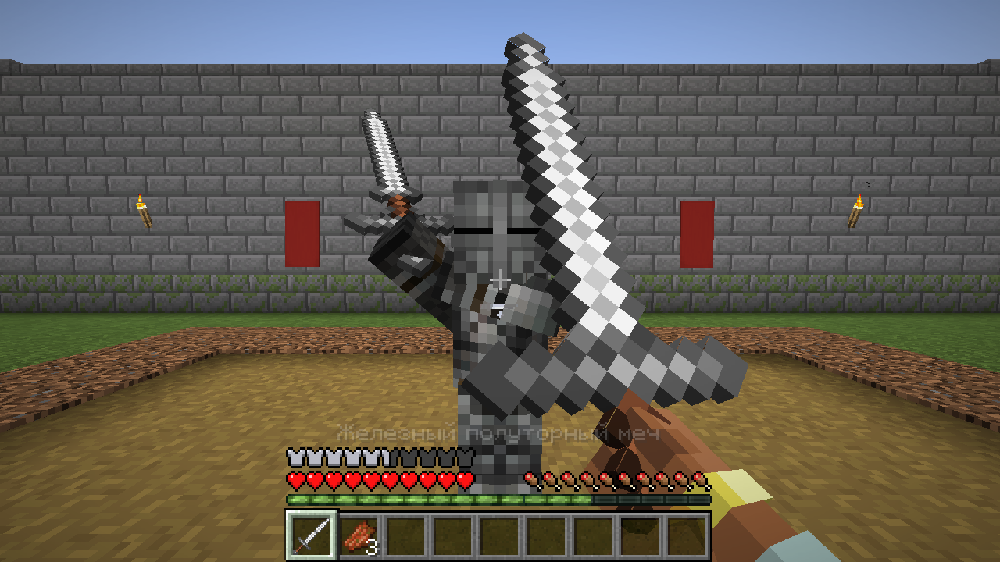
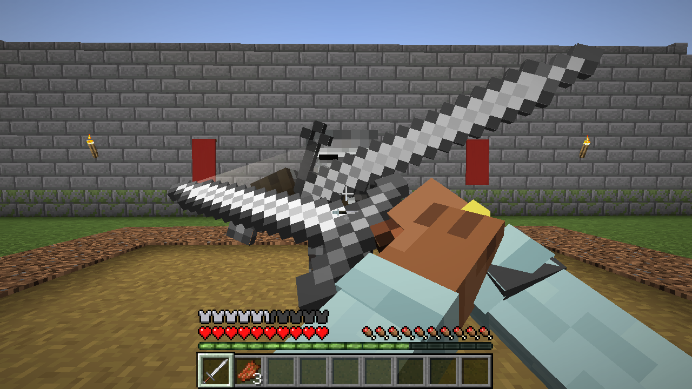
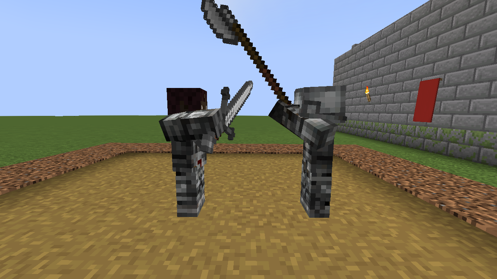
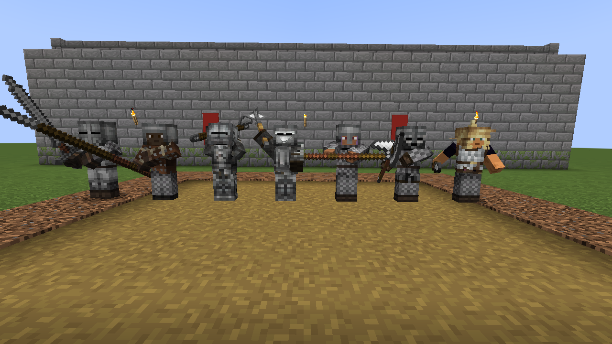
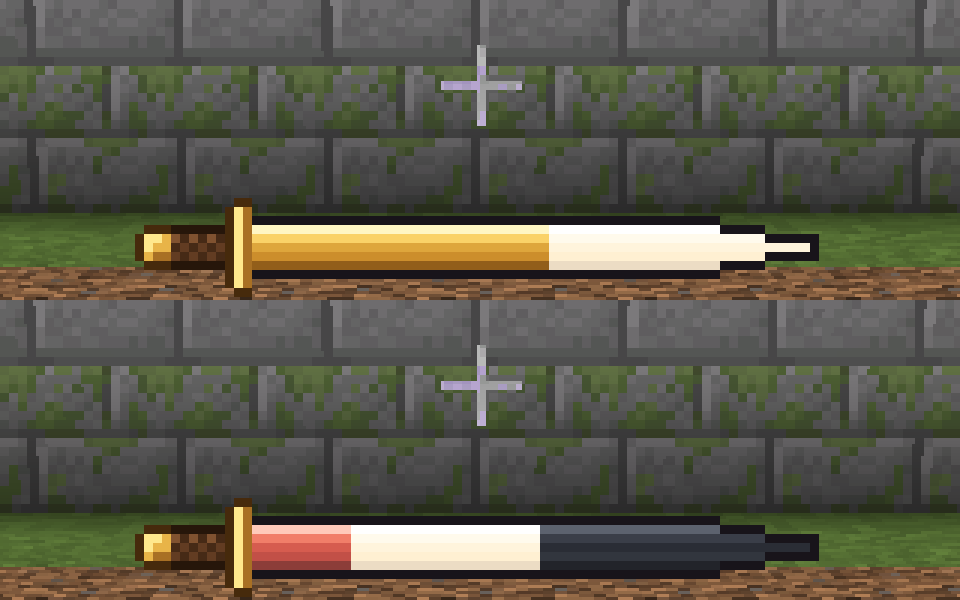
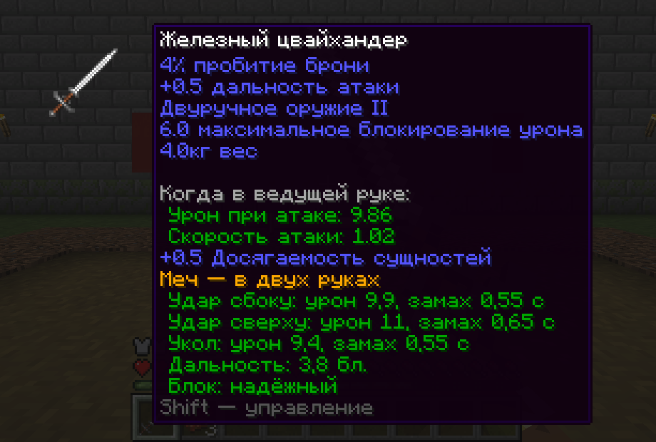

# Рыцарский бой — мод для Minecraft Forge 1.20.1

Ближний бой в духе Chivalry 2: удары с направлением (сбоку, сверху, укол) с замахом, ударом и восстановлением,
комбо, финты, блок и парирование, рипост, контратака, пинок, выносливость и боевой клич.
Своего оружия в моде нет: по новым правилам дерутся мечи и топоры Minecraft, всё оружие
[Epic Knights](https://modrinth.com/mod/epic-knights-shields-armor-and-weapons) и его аддонов
(Epic Knights: Addon, Slavic Armory, Antique Legacy) и оружие других модов.

- **Minecraft** 1.20.1, **Forge** 47.4.28 (подходит любой Forge 47.x)
- **ID мода:** `knightcombat`
- Работает в одиночной игре и на сервере. Мод нужен и серверу, и всем игрокам: правила боя считает сервер,
  клиент отправляет нажатия и рисует анимации.
- Epic Knights не обязателен. Если он установлен, мод сам читает характеристики его оружия.

| Противник замахивается | Удар сбоку от первого лица |
|------------------------|----------------------------|
|  |  |
| **Удар сверху против блока** | **Оружие Epic Knights и аддонов** |
|  |  |
| **Выносливость — меч, заполненный золотом** | **Подсказка оружия** |
|  |  |

## Управление

| Действие | Кнопка | Как работает |
|----------|--------|--------------|
| Удар сбоку | ЛКМ | Горизонтальный удар. Нажатие во время удара — комбо: следующий удар идёт в обратную сторону и с более коротким замахом |
| Удар сверху | колесо вверх или **R** | Медленнее, но сильнее |
| Укол | колесо вниз или **Z** | Быстрый и с самой большой дальностью |
| Блок | ПКМ (удерживать) | Первые 0,3 секунды блока — **парирование** |
| Финт | **G** | Отменить замах, чтобы обмануть противника |
| Пинок | **V** | Выбивает противника из блока |
| Боевой клич | **B** | Восстанавливает часть выносливости |
| Ломать блоки оружием | Shift + ЛКМ | Пока прицел на блоке и рядом нет врагов, ЛКМ и так ломает блоки |

Кнопки меняются в настройках управления (раздел «Рыцарский бой»). Если колесо мыши нужно для смены
слота, атаки колесом выключаются в `config/knightcombat-client.toml`.
ПКМ по двери, сундуку, жителю, лошади и т. п. работает как обычно: блок оружием ставится, когда прицел
на противнике (монстре или игроке) или ни на что не наведён. Лодки, вагонетки и рамки ломаются обычным ударом.
В подсказке к оружию с зажатым Shift видно управление.

## Как устроен бой

### Удар: замах, удар, восстановление
Каждый удар проходит три фазы:
1. **Замах** — противник видит, какой удар готовится. Во время замаха можно сделать финт или сменить
   удар (например, начать удар сбоку и превратить его в укол).
2. **Удар** — оружие движется по дуге, и всё, что оно задевает, получает урон. Удар сбоку проходит
   справа налево (в комбо — обратно), удар сверху — от головы вниз, укол — вперёд.
   Попадание считается по настоящей траектории клинка, поэтому важно, куда смотрит атакующий во время удара.
3. **Восстановление** — короткая пауза. Нажатие атаки во время удара или в начале восстановления запускает комбо.

Удар, попавший в стену, отскакивает: в узком коридоре удар сбоку бьёт о стены, лучше колоть или бить сверху.

### Защита
- **Блок** (ПКМ) отражает удары спереди и тратит выносливость. Пока держите блок, вы двигаетесь медленнее
  и выносливость не восстанавливается.
- **Парирование** — блок, поставленный перед самым ударом (в первые 0,3 секунды). Тратит вдвое меньше
  выносливости, а атакующий надолго «отскакивает» и не может сразу ударить снова.
- **Рипост** — атака сразу после парирования: замах намного короче, и до удара вы прикрыты, как блоком.
- **Контратака** — начать тот же удар, что летит в вас (сбоку против удара сбоку и т. д.), в самый последний
  момент. Ваш замах отражает вражеский удар и превращается в быстрый рипост.
- **Пинок** пробивает блок: противник теряет выносливость и на мгновение не может ничего делать.
- **Щит** в другой руке (в том числе щиты Epic Knights) работает как обычный щит и тоже тратит выносливость.
  Топоры, булавы, молоты и алебарды выбивают щиты.
- Блок оружием отражает и удары мобов, и стрелы. Парирование отбрасывает моба.

### Выносливость
Шкала под прицелом — меч, клинок которого заполнен золотом. Её тратят блоки, финты, смена удара, пинки и промахи:
потраченная часть на мгновение остаётся белой и потом стекает, при нехватке выносливости клинок краснеет и пульсирует,
пустая шкала мигает. Через секунду без трат выносливость начинает восстанавливаться (по клинку бежит блик). Если блок принимает удар, когда выносливость на нуле, **защита пробита**:
вы на секунду открыты.

### Сбитый замах
Любое попадание по вам во время замаха (кроме рипоста) сбивает его. Поэтому быстрое оружие
наказывает медленные замахи, а удар, начатый первым, не всегда успевает первым.

### Боевой клич
Поднимает оружие над головой с криком, восстанавливает 35 выносливости. Перезарядка — 20 секунд.

## Оружие

Оружием считаются:
- мечи и топоры Minecraft;
- всё оружие Epic Knights и его аддонов, кроме рыцарских копий (у них остаётся таранный удар Epic Knights);
- оружие других модов, сделанное как мечи и топоры Minecraft, и предметы с уроном от 3, в названии которых
  есть слово оружия (mace, halberd, spear, dagger и т. п.).

Характеристики берутся из самого предмета, поэтому оружие дерётся так, как задумал автор его мода:
- **урон** — урон предмета, умноженный на множитель удара (таблица ниже);
- **скорость атаки** задаёт длительность ударов: замах — около половины времени одной обычной атаки,
  удар — чуть больше трети, восстановление — снова половина;
- **дальность** — 3 блока для одноручного оружия (кинжал — 2,6), 3,3 для двуручного, 3,4 для древкового
  плюс бонус дальности предмета (у Epic Knights — его собственный), не больше 6,5;
- **выносливость** на удар — от веса оружия: у Epic Knights это его вес, у остальных — по скорости атаки.

Вид оружия мод узнаёт из данных Epic Knights (алебарды, двуручность, длина) и по названию предмета:

| Вид | Например | Сбоку / сверху / укол | Особенности |
|-----|----------|-----------------------|-------------|
| Меч | мечи, полуторные, цвайхендеры, фальшионы | 1 / 1,12 / 0,95 | ровный во всём |
| Колющий меч | эсток, рапира | 0,75 / 0,85 / 1,2 | укол быстрее и сильнее |
| Кинжал | кинжал, стилет, серп | 0,85 / 1 / 1,15 | самый быстрый, слабый блок |
| Топор | топоры, датский топор, франциска | 1 / 1,22 / 0,45 | выбивает щиты |
| Дробящее | булавы, молоты, моргенштерны, клевцы | 0,9 / 1,3 / 0,5 | медленнее сверху, выбивает щиты |
| Копьё | пики, копья, рогатины, протазаны | 0,7 / 0,85 / 1,15 | быстрый укол, большая дальность |
| Древковый топор | алебарды, бердыши, глефы, поллэксы | 1 / 1,22 / 0,8 | выбивает щиты |

**Хват.** Двуручное оружие (у Epic Knights — его двуручные мечи и топоры, у других модов — «great», «claymore»,
«longsword» и т. п. в названии) держится двумя руками и блокирует лучше; во второй руке при этом ничего не рисуется.
Древковое — копья и алебарды: длинные, тоже двумя руками.

**Epic Knights.** Бронебойность и урон серебром Epic Knights работают как в самом Epic Knights, а оружие,
которое в Epic Knights умеет блокировать, блокирует дешевле. Дробящее оружие других модов пробивает броню.

Урон без зачарований; «Острота», «Небесная кара», «Бич членистоногих», «Заговор огня», «Отдача»
и «Добыча» работают как обычно. Удары тяжёлого оружия сильнее отнимают выносливость у того, кто их блокирует.
В подсказке к оружию видно его вид, хват, урон и замах каждого удара, дальность и блок.
Если какое-то оружие должно драться по-старому, его можно исключить настройкой `excludedWeapons`.

## Настройки

Сервер — `serverconfig/knightcombat-server.toml` в папке мира:

| Параметр | По умолчанию | Описание |
|----------|--------------|----------|
| `vanillaWeapons` | true | Мечи и топоры Minecraft дерутся по правилам мода |
| `moddedWeapons` | true | Оружие Epic Knights, его аддонов и других модов дерётся по правилам мода |
| `excludedWeapons` | `*lance*`, `minecraft:trident` | Предметы, которые дерутся по-старому. `*` — любой текст: `magistuarmory:*` — всё Epic Knights |
| `wallsStopAttacks` | true | Стены останавливают удары |
| `maxStamina` | 100 | Запас выносливости |
| `staminaRegenPerSecond` | 25 | Восстановление выносливости в секунду |
| `damageMultiplier` | 1.0 | Множитель всего урона оружием |
| `battleCryCooldownSeconds` | 20 | Перезарядка боевого клича |

Клиент — `config/knightcombat-client.toml`:

| Параметр | По умолчанию | Описание |
|----------|--------------|----------|
| `scrollAttacks` | true | Колесо мыши: вверх — удар сверху, вниз — укол |
| `cameraSway` | true | Камера слегка следует за ударом |
| `staminaBar` | true | Шкала выносливости под прицелом |
| `hitMessages` | true | Сообщения у прицела: «Парирование!», «Защита пробита» и т. п. |
| `swingTrails` | true | След за клинком при ударе |
| `firstPersonArms` | true | Руки, держащие оружие, от первого лица |
| `weaponScale` | 1.0 | Размер оружия в руке (0,5–2) по сравнению с тем, что выбирает мод |

## Сборка

Мод собирается вместе с остальными модами репозитория (см. [README в корне](../README.md)):

| Команда | Что делает |
|---------|-----------|
| `./gradlew :knightcombat:build` | Собирает мод в `knightcombat/build/libs/knightcombat-2.0.0.jar` и запускает тесты |
| `./gradlew :knightcombat:runClient` | Запускает Minecraft с модом |
| `./gradlew :knightcombat:runClient -PepicKnights` | То же вместе с Epic Knights, его тремя аддонами, Architectury и Cloth Config (скачиваются с Modrinth) |
| `./gradlew :knightcombat:runServer` | Запускает выделенный сервер с модом |

## Устройство проекта

```
src/main/java/io/github/nicksementsov/knightcombat/
  KnightCombat.java, CombatConfig.java   главный класс мода и настройки
  combat/       правила боя на сервере: фазы ударов, блоки, парирования, выносливость,
                траектории клинка и попадания; виды и характеристики оружия, данные Epic Knights
  network/      пакеты: нажатия игрока, состояние бойца для анимаций, выносливость, события боя
  registry/     регистрация звуков
  client/       управление, позы от первого и третьего лица, оружие в руке, следы ударов,
                камера, шкала выносливости, подсказки
src/main/resources/
  assets/knightcombat/   звуки, текстура шкалы выносливости, переводы (ru_ru, en_us)
src/test/java/          тесты геометрии ударов, математики поз и измерения моделей оружия
tools/generate_sounds.py   синтезирует все звуки и sounds.json
tools/generate_assets.py   рисует шкалу выносливости и логотип
```

### Как сделаны анимации
Позы задаются направлениями: куда смотрит рука, куда направлен клинок и в какую сторону обращено лезвие
(у топора и алебарды туда смотрит голова оружия). Модели оружия у разных модов разные — плоские текстуры любого
размера, 3D-модели, свои настройки положения в руке, — поэтому мод измеряет модель каждого оружия (где рукоять,
куда идёт клинок, с какой стороны голова) и поворачивает её саму, ничего не заменяя: оружие выглядит так,
как его нарисовал автор мода, только немного крупнее (двуручное — заметнее; и так огромные модели не увеличиваются).

От третьего лица мод ставит руки модели игрока (через позу руки Forge), поворачивает корпус и голову, поднимает
ногу для пинка. Двуручное оружие держат обе руки. Удар сбоку идёт лезвием вперёд с поворотом корпуса, удар
сверху — с подъёмом на замахе и наклоном вперёд, укол — с выпадом. Отбитый блоком или стеной удар отскакивает,
в стойке оружие чуть поднимается и опускается с дыханием, при боевом кличе оружие вскинуто и дрожит.

От первого лица видны руки, держащие оружие: они входят в кадр из нижних углов, у двуручного оружия — обе.
Плоскость клинка повёрнута к игроку, чтобы оружие было видно; попадание встряхивает оружие, камера слегка следует
за ударом. За клинком остаётся след; он строится по самой траектории удара, поэтому плавный при любом FPS.

### Звуки и текстуры
Все звуки свои: их синтезирует скрипт из шума, резонаторов, неровных обертонов металла и формантного голоса —
свист клинка (отдельно для лёгкого и тяжёлого оружия), звон блока, звонкое парирование, пробитая защита, попадание,
удар о стену, финт, пинок и боевой клич (несколько рыцарей кричат «А-а-а!», «Ура-а!», «Хо-о!»).
Шкалу выносливости и логотип рисует второй скрипт.

```bash
pip install pillow numpy                  # и ffmpeg с кодеком libvorbis
python3 knightcombat/tools/generate_sounds.py
python3 knightcombat/tools/generate_assets.py
```

Записанных или взятых из других игр звуков в моде нет. Из Chivalry 2 взяты только идеи механик.
