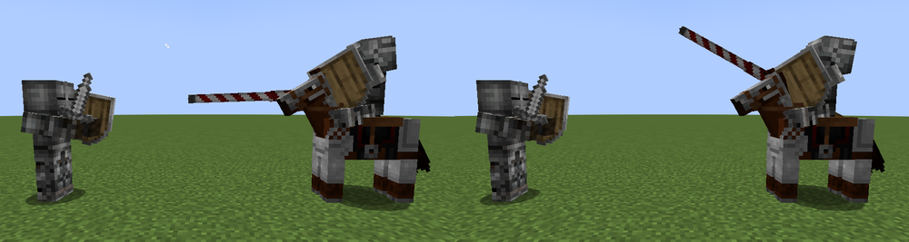
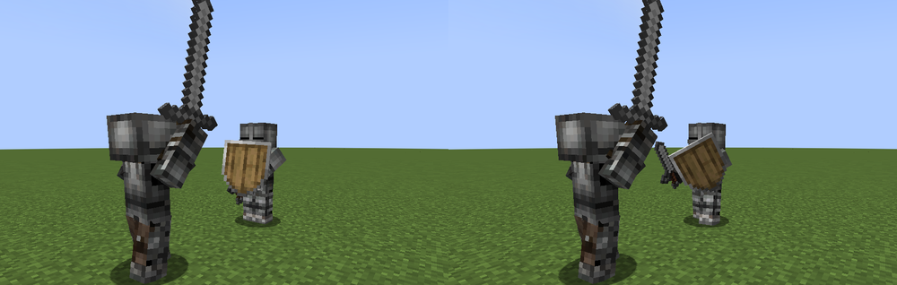
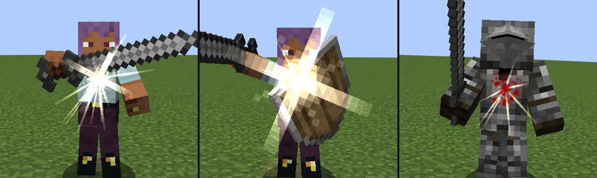
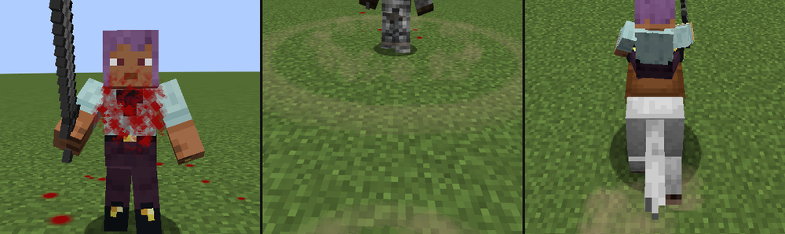

# Рыцарский бой — мод для Minecraft Forge 1.20.1

Ближний бой в духе Chivalry 2: удары с направлением (сбоку, сверху, укол) с замахом, ударом и восстановлением,
тяжёлые удары, комбо с добивающими ударами, финты и отмены, блок и парирование, щиты со своей анимацией, рипост,
контратака, пинок и удар щитом, уклонения, броски оружия, таран копьём на коне, выносливость и боевой клич.
Своего оружия в моде нет: по новым правилам дерутся мечи и топоры Minecraft, всё оружие
[Epic Knights](https://modrinth.com/mod/epic-knights-shields-armor-and-weapons) и его аддонов
(Epic Knights: Addon, Slavic Armory, Antique Legacy, Dark Ages) и оружие других модов.

- **Minecraft** 1.20.1, **Forge** 47.4.28 (подходит любой Forge 47.x)
- **ID мода:** `knightcombat`
- Работает в одиночной игре и на сервере. Мод нужен и серверу, и всем игрокам: правила боя считает сервер,
  клиент отправляет нажатия и рисует анимации.
- Epic Knights не обязателен. Если он установлен, мод сам читает характеристики его оружия.


| Противник замахивается | Удар сбоку от первого лица |
|------------------------|----------------------------|
|  |  |
| **Удар сверху против блока** | **Оружие Epic Knights и аддонов** |
|  |  |
| **Выносливость — меч, заполненный золотом** | **Подсказка оружия** |
|  |  |
| **Добивающий удар «Вихрь»: разворот вокруг себя** | **Бросок: меч через плечо, пика в стене, булава в полёте** |
|  |  |
| **Таран: копьё опущено, после удара вскинуто** | **Щиты: блок с мечом наготове, круглый щит без оружия, щит в покое** |
|  |  |
| **Искры и вспышки: пробитая защита, удар по щиту, удар по латам** | **Кровь, кольцо пыли от боевого клича, пыль из-под копыт** |
|  |  |

## Управление

| Действие | Кнопка | Как работает |
|----------|--------|--------------|
| Удар сбоку | ЛКМ | Горизонтальный удар. Нажатие во время удара — комбо: следующий удар идёт в обратную сторону и с более коротким замахом |
| Удар сверху | колесо вверх или **R** | Медленнее, но сильнее |
| Укол | колесо вниз или **Z** | Быстрый и с самой большой дальностью |
| **Тяжёлый удар** | удерживать ЛКМ, **R** или **Z** | Замах дольше, оружие отводится дальше и дрожит; удар сильнее, сильнее отбрасывает и выбивает выносливость из блока |
| Блок | ПКМ (удерживать) | Первые 0,3 секунды блока — **парирование**. Со щитом в другой руке ПКМ поднимает щит |
| Финт | **G** | Отменить замах, чтобы обмануть противника |
| Пинок | **V** | Выбивает противника из блока; удар сразу после попавшего пинка выходит быстрее. Со щитом — **удар щитом** |
| **Бросок оружия** | **H** | Оружие летит туда, куда смотрите, втыкается в стены, его можно подобрать |
| **Уклонение** | **Левый Alt** + направление или двойное нажатие **A**, **D**, **S** | Быстрый шаг вбок, назад или вперёд |
| **Таран копьём** | ПКМ (удерживать) на коне с копьём | Копьё опускается под мышку и бьёт само: чем быстрее конь, тем сильнее |
| Боевой клич | **B** | Восстанавливает часть выносливости |
| Ломать блоки оружием | Shift + ЛКМ | Пока прицел на блоке и рядом нет врагов, ЛКМ и так ломает блоки |

Кнопки меняются в настройках управления (раздел «Рыцарский бой»). Если колесо мыши нужно для смены
слота, атаки колесом выключаются в `config/knightcombat-client.toml`.
ПКМ по двери, сундуку, жителю, лошади и т. п. работает как обычно: блок оружием ставится, когда прицел
на противнике (монстре или игроке) или ни на что не наведён. Лодки, вагонетки и рамки ломаются обычным ударом.
В подсказке к оружию с зажатым Shift видно управление.

## Как устроен бой

### Удар: замах, удар, восстановление
Каждый удар проходит три фазы:
1. **Замах** — противник видит, какой удар готовится. Во время замаха можно сделать финт или сменить
   удар (например, начать удар сбоку и превратить его в укол).
2. **Удар** — оружие движется по дуге, и всё, что оно задевает, получает урон. Удар сбоку проходит
   справа налево (в комбо — обратно), удар сверху — от головы вниз, укол — вперёд.
   Попадание считается по настоящей траектории клинка, поэтому важно, куда смотрит атакующий во время удара.
3. **Восстановление** — короткая пауза. Нажатие атаки во время удара или в начале восстановления запускает комбо.

Удар, попавший в стену, отскакивает: в узком коридоре удар сбоку бьёт о стены, лучше колоть или бить сверху.

### Защита
- **Блок** (ПКМ) отражает удары спереди и тратит выносливость. Пока держите блок, вы двигаетесь медленнее
  и выносливость не восстанавливается.
- **Парирование** — блок, поставленный перед самым ударом (в первые 0,3 секунды). Тратит вдвое меньше
  выносливости, а атакующий надолго «отскакивает» и не может сразу ударить снова.
- **Рипост** — атака сразу после парирования: замах намного короче, и до удара вы прикрыты, как блоком.
- **Контратака** — начать тот же удар, что летит в вас (сбоку против удара сбоку и т. д.), в самый последний
  момент. Ваш замах отражает вражеский удар и превращается в быстрый рипост.
- **Пинок** пробивает блок: противник теряет выносливость и на мгновение не может ничего делать.
- **Щит** в другой руке работает по правилам мода (подробнее — ниже).
- Блок оружием отражает и удары мобов, и стрелы. Парирование отбрасывает моба.

### Щиты
Работают щит Minecraft, все щиты Epic Knights и его аддонов (баклеры, тарчи, павезы, каплевидные, круглые и другие)
и щиты других модов. Щит держат в другой руке рядом с одноручным оружием (или вообще без оружия).

**Двуручное оружие и щит вместе не носятся.** Двуручные мечи и топоры и древковое оружие (пики, алебарды, двуручные
копья) держат обеими руками: стоит взять такое оружие, щит из другой руки убирается в инвентарь (если места нет — падает под
ноги), а у прицела появляется надпись. Возьмёте одноручное оружие или уберёте двуручное — щит сам вернётся в руку.
Выключается настройкой сервера `twoHandedPutsAwayShield`.

- **ПКМ** поднимает щит. Первые мгновения после подъёма — **парирование**, как у блока оружием: атакующего отбрасывает,
  а у вас открывается рипост. Дальше щит просто блокирует.
- Каждый удар по щиту тратит выносливость, но меньше, чем блок оружием. Стрелы и брошенное оружие — ещё вдвое меньше.
  Удары мобов щит тоже принимает на себя и отталкивает их. Пока щит поднят, выносливость не восстанавливается.
- **Размер щита** важен:

  | Щит | Например | Прикрывает спереди | Парирование | Удар по щиту стоит |
  |-----|----------|--------------------|-------------|--------------------|
  | Малый | баклер, тарч, рондаш, пельта | 110° | 0,4 с | 60% |
  | Средний | щит Minecraft, каплевидный, круглый, гербовый | 160° | 0,3 с | 40% |
  | Большой | павеза, скутум, гоплон, тиреос, дуэльный щит | 190° | 0,25 с | 28% |

- **Топоры, булавы и алебарды** тратят на 50% больше выносливости щита, а **тяжёлый удар** ими выбивает щит из руки
  на 5 секунд, и боец пошатывается. Закончилась выносливость — щит выбит, защита пробита.
- **Удар из-за щита**: ЛКМ, **R** или **Z** с поднятым щитом опускают его и сразу бьют (после парирования — рипост).
- **Удар щитом** (**V** со щитом в руке) вместо пинка: выходит быстрее, отбрасывает сильнее и тоже выбивает
  противника из блока. Пинок или удар щитом по поднятому щиту выбивает его на 3 секунды.
- С поднятым щитом можно идти примерно вдвое медленнее обычного (сам Minecraft замедляет впятеро), с большим — медленнее.
  Посреди атаки, пинка, броска или уклонения щит не поднять.
- **Анимация щита своя, а не Minecraft.** Щит поднимается плавно. От третьего лица рыцарь разворачивается щитом к
  противнику и чуть пригибается за ним, щит закрывает грудь, а одноручное оружие занесено над щитом остриём вперёд.
  От первого лица щит выходит в левую нижнюю часть экрана, верхний край чуть ниже прицела. Удар по щиту отбрасывает его
  назад и встряхивает, парирование выталкивает щит навстречу удару, удар щитом — рывок плечом вперёд. Так же поднимают
  щит и без оружия в руке.
- В подсказке к щиту видно его размер, прикрытие, парирование и цену блока.

### Таран копьём на коне
Для тарана годятся турнирные (кавалерийские) копья Epic Knights, предметы с «lance» в названии и всё оружие вида
«Копьё» (пики, копья, рогатины, протазаны).

- Сидя на лошади (осле, муле, верблюде) с копьём в руке, **зажмите ПКМ**: рыцарь опускает копьё и зажимает его под
  мышкой, остриё смотрит вперёд. Отпустите ПКМ — копьё снова поднято.
- С опущенным копьём разгоните коня. Стрелки под прицелом показывают силу удара: на рыси копьё бьёт слабо, на полном
  скаку — в полную силу (стрелки становятся золотыми), а поле зрения расширяется с разгоном.
- Копьё бьёт само — первого, на кого наткнётся: урон оружия ×0,8 на рыси и до ×3 на полном скаку (не больше 40).
  Пронзённого отбрасывает вдоль удара, а удар больше чем в полсилы **выбивает всадника из седла**. После удара копьё
  вскидывается вверх и снова готово через 0,9 секунды.
- Целятся взглядом. Копьё идёт чуть ниже взгляда: смотрите пешему в голову — попадёте в грудь. Выше 15° и ниже 30°
  копьё не наклоняется. Если копьё проходит над шеей коня противника, оно бьёт всадника.
- Против тарана помогают блок и особенно щит: удар принимается, но стоит много выносливости и прочности щита, а
  всадника со щитом всё равно может выбить из седла. Если выносливость кончилась, защита пробита и удар проходит.
- Удар о стену на скаку отбрасывает копьё. Своих лошадей и питомцев копьё не задевает.
- Epic Knights сам бьёт опущенными копьями. Пока таран включён, мод держит копья Epic Knights поднятыми для самого
  Epic Knights, и бьёт только таран мода. С `mountedCharges = false` копья работают как в Epic Knights.

### Выносливость
Шкала под прицелом — меч, клинок которого заполнен золотом. Её тратят блоки, финты, смена удара, пинки и промахи:
потраченная часть на мгновение остаётся белой и потом стекает, при нехватке выносливости клинок краснеет и пульсирует,
пустая шкала мигает. Через секунду без трат выносливость начинает восстанавливаться (по клинку бежит блик). Если блок принимает удар, когда выносливость на нуле, **защита пробита**:
вы на секунду открыты.

### Тяжёлые удары
Если держать кнопку удара (ЛКМ, **R** или **Z**) до конца замаха, удар становится тяжёлым: боец с натугой отводит
оружие ещё дальше, руки дрожат, у прицела сходятся четыре метки заряда. Тяжёлый удар наносит примерно в полтора раза больше
урона, сильнее отбрасывает, в 1,6 раза сильнее выбивает выносливость из блока и всегда сопровождается криком, но стоит
8 выносливости и дольше восстанавливается. Пока он заряжается, его можно сбить, отменить финтом или блоком, а
контратакой его не поймать. Удары колесом мыши всегда обычные.

### Комбо и добивающие удары
Удар, нажатый во время предыдущего удара или в начале восстановления, продолжает серию. Некоторые серии заканчиваются
**добивающим ударом**: у прицела появляется его название, след клинка становится золотым, а сам удар сильнее и выглядит иначе.

| Серия | Добивающий | Что делает |
|-------|------------|-----------|
| сбоку → сбоку → сбоку | **Вихрь** | Третий удар идёт по широкой дуге (230° вместо 160°), рыцарь разворачивается вокруг себя; урон ×1,25 |
| сбоку → сбоку → сверху | **Мельница** | Клинок описывает круг сбоку и быстро обрушивается сверху; урон ×1,35 |
| сверху → сверху | **Молот** | Второй удар заносится выше и бьёт со всего тела; урон ×1,3, из блока выбивает в 1,6 раза больше выносливости |
| укол → укол → укол | **Жало** | Глубокий выпад: дальность +0,8 блока, урон ×1,3, замах короче |
| укол → сбоку | **Подсечка** | Низкий режущий удар по ногам: урон ×1,15 и замедление на 2 секунды |
| пинок → любой удар | быстрый удар | Удар сразу после попавшего пинка выходит почти вдвое быстрее |

После добивающего удара серия начинается заново, блок, финт или пауза тоже её прерывают.

### Удар с разбега
Атака, начатая на бегу, сильнее (×1,25), чуть быстрее и несёт далеко вперёд, но после неё дольше восстанавливаться.

### Отмена атаки
Замах можно отменить несколькими способами, каждый стоит выносливости, как финт (10):
- **финт** (**G**) — оружие возвращается в стойку, сразу можно бить снова;
- **блок** (ПКМ) — замах переходит в блок с парированием;
- **пинок** (**V**), **бросок** (**H**) или **уклонение** (**Alt**) прямо из замаха;
- **смена удара** — нажать другой удар в первой части замаха (6 выносливости).

### Уклонение
**Левый Alt** — шаг в ту сторону, куда вы идёте (без движения — назад), или двойное нажатие **A**, **D** или **S**.
Рыцарь отскакивает примерно на два блока, корпус наклоняется в сторону шага. Уклонение стоит 14 выносливости,
следующее возможно через 0,4 секунды после окончания. Неуязвимости нет: уклонение уводит из-под дуги удара. Двойное нажатие
выключается в настройках клиента (`doubleTapDodge`).

### Бросок оружия
**H** — замах через плечо и бросок туда, куда смотрите. Мечи, топоры и булавы летят, вращаясь, копья и эстоки — остриём
вперёд. Урон зависит от оружия: кинжалы (×1,5), копья (×1,4) и топоры (×1,25) созданы для броска, мечи бьют на свой урон,
древковые топоры слабее. Метательное оружие — дротики (javelin, pilum, angon, сулица) и франциски — бьёт ещё в 1,3 раза
сильнее и летит быстрее. Броску мешают блок и щит, как стреле. Оружие на лету свистит, попав в цель, падает к её ногам,
в стену или в землю на лету — втыкается и дрожит, булавы отскакивают от стен с лязгом. Подобрать брошенное оружие может
любой, просто пройдя по нему; если рука пустая, оружие сразу ложится в руку. Неподобранное оружие через 5 минут
становится обычным предметом. В творческом режиме оружие остаётся в руке.

### Сбитый замах
Любое попадание по вам во время замаха (кроме рипоста) сбивает его. Поэтому быстрое оружие
наказывает медленные замахи, а удар, начатый первым, не всегда успевает первым.

### Боевой клич
Поднимает оружие над головой с криком, восстанавливает 35 выносливости. Перезарядка — 20 секунд.
В бою рыцари и без клича кричат: выкрикивают при ударе (чаще при ударах сверху и тяжёлым оружием) и вскрикивают
от боли, когда их ранит оружие.

### Анимации
- **Обнажение оружия.** Взятое в руку оружие поднимается от бедра с росчерком, и слышен звук клинка из ножен.
- **Заряд тяжёлого удара** — оружие уходит дальше назад, корпус закручивается, руки дрожат.
- **Добивающие удары** — свои замахи и удары: разворот вокруг себя у вихря, круг клинком у мельницы, низкая стойка
  у подсечки, глубокий выпад у жала.
- **Бросок** — оружие заносится через плечо, вторая рука указывает цель, бросок с шагом вперёд.
- **Уклонение** — наклон всего тела в сторону шага, от первого лица оружие уводит в другую сторону.
- **Бег** — оружие несут низко у бедра остриём вперёд (двуручное — наискось через грудь), рыцарь наклоняется в бег,
  рука с оружием раскачивается в такт шагам.
- **Прыжок** — оружие приподнимается, свободная рука отходит в сторону для равновесия.
- **Блок оружием** — удар по блоку отбрасывает оружие к телу и раскачивает рыцаря назад, а парирование отводит клинок
  наружу и вверх, навстречу удару.
- **Осмотр оружия.** Постояв без дела 12 секунд, рыцарь осматривает оружие: подносит меч к лицу, поворачивает его
  плашмя и ребром и прокручивает в руке; двуручное кладёт на плечо; древковое ставит рядом и опирается на него.
  Выключается настройкой клиента `idleAnimations`.
- **Копьё на коне** — поднятое копьё стоит у плеча остриём вверх. Опущенное зажато под мышкой и смотрит вперёд через
  шею коня, рыцарь подаётся вперёд. При ударе копьё подбрасывает вверх, а всадника откидывает назад. От первого лица
  опущенное копьё уходит от правого нижнего угла к центру экрана.

### Динамика боя
Каждый удар ощущается, причём не только тем, кто бьёт:
- **Тряска камеры.** Попадание, блок, парирование, пробитая защита, пинок и удар о стену трясут камеру. Чем тяжелее
  оружие, тем сильнее; кто стоит рядом, тоже чувствует удары. Камеру ещё и толкает в сторону удара: попадание сбоку
  отворачивает голову, отбитый удар подбрасывает оружие вверх. Тряска пружинит и за секунду затихает.
- **Стоп-кадр.** Попавший удар на мгновение замирает, будто клинок завяз в цели; у тяжёлого оружия и при убийстве
  дольше. Отбитые и парированные удары тоже «цепляются» сталью.
- **Отдача.** Тяжёлые удары отбрасывают противника, удар сверху — сильнее всего. Блокирующего тяжёлый удар отталкивает
  назад, пробитая защита сбивает с ног, парированного атакующего отбрасывает на шаг.
- **Рывок.** Атака несёт вперёд: укол — дальше всего (около полублока), удар сверху и сбоку — меньше.
- **Реакция на удар.** Ударенный рыцарь вздрагивает: корпус отворачивается от удара, голова откидывается, плечи уходят
  назад. От первого лица оружие сбивает вниз и в сторону.
- **Вспышки.** Края экрана вспыхивают красным, когда по вам попали, светлым — при удачном парировании, золотым —
  при убийстве и тёмно-красным пульсируют, пока кончается выносливость.
- **Взгляд.** Пока заносится тяжёлый удар, поле зрения чуть сужается, а при ударе и попадании толчком раскрывается.
- **Искры, кровь, щепки и пыль.** Сталь о сталь и удар по латам высекают искры: они разлетаются, падают и остывают
  от белого к красному. При парировании и пробитой защите между клинками вспыхивает звезда. Попадание брызжет кровью
  (у нежити она темнее, у пауков зеленоватая); капли падают и пару секунд лежат пятнами на земле, а у скелетов,
  големов и слизней крови нет. Щит под ударом летит щепками — кусочками самого щита, — как и копьё при таране.
  Уклонение, удар с разбега, пинок, тяжёлое приземление и конь в галопе поднимают пыль цвета земли под ногами,
  от боевого клича по земле расходится кольцо пыли. Выключается настройками клиента `particleEffects` и
  `bloodEffects`; при «уменьшенных» частицах Minecraft их меньше, при «минимальных» нет совсем.
- **Звуки.** Поднятый щит глухо стукает; удар топора или булавы по щиту, пробитая щитовая защита и сильный удар копья
  трещат досками, а стрела втыкается в щит с деревянным стуком. Парированный клинок и отбитый укол скрежещут по
  стали, древко копья трещит при сильном таране, топор, булава и тяжёлый удар добивают с хрустом костей.
  Выдохшийся рыцарь тяжело дышит, пока не восстановит силы. Кольчуга и латы позвякивают на каждом шаге и лязгают
  при уклонении, тяжёлом приземлении и пробитой защите; кожа и ткань (стёганки, туники, плащи) молчат.
  Осматриваемый клинок тихо звенит.

## Оружие

Оружием считаются:
- мечи и топоры Minecraft;
- всё оружие Epic Knights и его аддонов, кроме рыцарских копий: ими бьют тараном на коне (см. «Таран копьём на коне»);
- оружие других модов, сделанное как мечи и топоры Minecraft, и предметы с уроном от 3, в названии которых
  есть слово оружия (mace, halberd, spear, dagger и т. п.).

Характеристики берутся из самого предмета, поэтому оружие дерётся так, как задумал автор его мода:
- **урон** — урон предмета, умноженный на множитель удара (таблица ниже);
- **скорость атаки** задаёт длительность ударов: замах — около половины времени одной обычной атаки,
  удар — чуть больше трети, восстановление — снова половина;
- **дальность** — 3 блока для одноручного оружия (кинжал — 2,6), 3,3 для двуручного, 3,4 для древкового
  плюс бонус дальности предмета (у Epic Knights — его собственный), не больше 6,5;
- **выносливость** на удар — от веса оружия: у Epic Knights это его вес, у остальных — по скорости атаки.

Вид оружия мод узнаёт из данных Epic Knights (алебарды, двуручность, длина) и по названию предмета:

| Вид | Например | Сбоку / сверху / укол | Особенности |
|-----|----------|-----------------------|-------------|
| Меч | мечи, полуторные, цвайхендеры, фальшионы | 1 / 1,12 / 0,95 | ровный во всём |
| Колющий меч | эсток, рапира | 0,75 / 0,85 / 1,2 | укол быстрее и сильнее |
| Кинжал | кинжал, стилет, серп, сика, малые саксы | 0,85 / 1 / 1,15 | самый быстрый, слабый блок |
| Топор | топоры, датский и византийский топоры, франциска | 1 / 1,22 / 0,45 | выбивает щиты |
| Дробящее | булавы, молоты, моргенштерны, клевцы | 0,9 / 1,3 / 0,5 | медленнее сверху, выбивает щиты |
| Копьё | пики, копья, рогатины, протазаны, дору, сарисса, дротики | 0,7 / 0,85 / 1,15 | быстрый укол, большая дальность |
| Древковый топор | алебарды, бердыши, глефы, поллэксы | 1 / 1,22 / 0,8 | выбивает щиты |

**Хват.** Двуручное оружие (у Epic Knights — его двуручные мечи и топоры, у других модов — «great», «claymore»,
«longsword» и т. п. в названии) держится двумя руками и блокирует лучше; щит с ним не носится (см. «Щиты»).
Древковое — алебарды и длинные копья: тоже двумя руками. Одноручные копья Epic Knights и аддонов (копья викингов,
дору, копьё триариев, дротики) держат одной рукой, со щитом, как в строю; очень длинные (сарисса, пика) — всегда двумя.

**Аддоны Epic Knights.** Оружие Epic Knights: Addon, Slavic Armory, Antique Legacy и Dark Ages мод читает так же, как
оружие самого Epic Knights (хват, вес, дальность, блок), а вид узнаёт по названию: мечи викингов и саксов, сабли и
скрамасакс — мечи, малые саксы — кинжалы, топоры викингов (датские — двуручные) — топоры, гладиусы и спаты — мечи,
сика — кинжал, рогатины и бердыши — древковое оружие.

**Epic Knights.** Бронебойность и урон серебром Epic Knights работают как в самом Epic Knights, а оружие,
которое в Epic Knights умеет блокировать, блокирует дешевле. Дробящее оружие других модов пробивает броню.

Урон без зачарований; «Острота», «Небесная кара», «Бич членистоногих», «Заговор огня», «Отдача»
и «Добыча» работают как обычно. Удары тяжёлого оружия сильнее отнимают выносливость у того, кто их блокирует.
В подсказке к оружию видно его вид, хват, урон и замах каждого удара, дальность и блок.
Если какое-то оружие должно драться по-старому, его можно исключить настройкой `excludedWeapons`.

## Настройки

Сервер — `serverconfig/knightcombat-server.toml` в папке мира:

| Параметр | По умолчанию | Описание |
|----------|--------------|----------|
| `vanillaWeapons` | true | Мечи и топоры Minecraft дерутся по правилам мода |
| `moddedWeapons` | true | Оружие Epic Knights, его аддонов и других модов дерётся по правилам мода |
| `excludedWeapons` | `*lance*`, `minecraft:trident` | Предметы, которые дерутся по-старому. `*` — любой текст: `magistuarmory:*` — всё Epic Knights |
| `wallsStopAttacks` | true | Стены останавливают удары |
| `maxStamina` | 100 | Запас выносливости |
| `staminaRegenPerSecond` | 25 | Восстановление выносливости в секунду |
| `damageMultiplier` | 1.0 | Множитель всего урона оружием |
| `battleCryCooldownSeconds` | 20 | Перезарядка боевого клича |
| `attackYells` | true | Бойцы иногда выкрикивают при ударе и кричат от боли, когда их ранит оружие |
| `heavyAttacks` | true | Удержание кнопки удара делает тяжёлый удар |
| `comboFinishers` | true | Добивающие удары в конце серий и быстрый удар после пинка |
| `weaponThrowing` | true | Оружие можно бросать |
| `dodges` | true | Уклонения |
| `shields` | true | Щиты по правилам мода: парирование при подъёме, выносливость, удар щитом, тяжёлые удары топорами и булавами выбивают щит |
| `mountedCharges` | true | Таран копьём на коне: копья Epic Knights, копья и пики бьют сами, сила зависит от скорости коня |
| `twoHandedPutsAwayShield` | true | Двуручное оружие держат обеими руками: щит из другой руки убирается в инвентарь, пока оно в руке, и возвращается потом |

Клиент — `config/knightcombat-client.toml`:

| Параметр | По умолчанию | Описание |
|----------|--------------|----------|
| `scrollAttacks` | true | Колесо мыши: вверх — удар сверху, вниз — укол |
| `cameraSway` | true | Камера слегка следует за ударом |
| `staminaBar` | true | Шкала выносливости под прицелом |
| `hitMessages` | true | Сообщения у прицела: «Парирование!», «Защита пробита» и т. п. |
| `swingTrails` | true | След за клинком при ударе |
| `firstPersonArms` | true | Руки, держащие оружие, от первого лица |
| `weaponScale` | 1.0 | Размер оружия в руке (0,5–2) по сравнению с тем, что выбирает мод |
| `cameraShake` | 1.0 | Сила тряски камеры, толчков и рывков поля зрения (0 — выключить, до 2) |
| `hitStop` | true | Стоп-кадр: попавший удар на мгновение замирает |
| `attackLunge` | true | Атаки несут вперёд |
| `screenEffects` | true | Вспышки краёв экрана при попадании, парировании, убийстве и нехватке выносливости |
| `doubleTapDodge` | true | Двойное нажатие A, D или S — уклонение (клавиша уклонения работает всегда) |
| `idleAnimations` | true | Постояв без дела, рыцарь осматривает оружие |
| `particleEffects` | true | Искры, вспышки, щепки щитов и копий, пыль из-под ног и копыт |
| `bloodEffects` | true | Кровь от попаданий и пятна на земле (нужен `particleEffects`) |

## Сборка

Мод собирается вместе с остальными модами репозитория (см. [README в корне](../README.md)):

| Команда | Что делает |
|---------|-----------|
| `./gradlew :knightcombat:build` | Собирает мод в `knightcombat/build/libs/knightcombat-2.7.0.jar` и запускает тесты |
| `./gradlew :knightcombat:runClient` | Запускает Minecraft с модом |
| `./gradlew :knightcombat:runClient -PepicKnights` | То же вместе с Epic Knights, его аддонами Addon, Slavic Armory и Antique Legacy, Architectury и Cloth Config (скачиваются с Modrinth). Epic Knights: Dark Ages есть только на CurseForge: положите его jar в `knightcombat/devmods/epic-knights-dark-ages-1.1.jar` (папка не в git), и он запустится тоже |
| `./gradlew :knightcombat:runServer` | Запускает выделенный сервер с модом |

## Устройство проекта

```
src/main/java/io/github/nicksementsov/knightcombat/
  KnightCombat.java, CombatConfig.java   главный класс мода и настройки
  combat/       правила боя на сервере: фазы ударов, тяжёлые удары, комбо, блоки, щиты, парирования, уклонения,
                броски, таран копьём, выносливость, траектории клинка и попадания; виды и характеристики оружия,
                данные Epic Knights
  entity/       брошенное оружие: полёт, попадание, втыкание, подбор
  network/      пакеты: нажатия игрока, состояние бойца для анимаций, выносливость, события боя
  registry/     регистрация звуков, частиц и сущности
  client/       управление, позы от первого и третьего лица, оружие в руке и в полёте, следы ударов,
                камера, частицы (искры, кровь, щепки, пыль), шкала выносливости, названия комбо, подсказки
src/main/resources/
  assets/knightcombat/   звуки, текстуры частиц и шкалы выносливости, переводы (ru_ru, en_us)
  data/                  тип урона брошенным оружием (сообщение о смерти)
src/test/java/          тесты геометрии ударов, комбо, щитов, доспехов, скорости коня для тарана, математики поз
                        и измерения моделей оружия
tools/import_sounds.py     собирает звуки из записей открытых библиотек, sounds.json и credits.txt
tools/import_particles.py  делает текстуры частиц из открытого набора частиц и их описания
tools/generate_assets.py   рисует шкалу выносливости, рамку вспышек экрана и логотип
```

### Как сделаны анимации
Позы задаются направлениями: куда смотрит рука, куда направлен клинок и в какую сторону обращено лезвие
(у топора и алебарды туда смотрит голова оружия). Модели оружия у разных модов разные — плоские текстуры любого
размера, 3D-модели, свои настройки положения в руке, — поэтому мод измеряет модель каждого оружия (где рукоять,
куда идёт клинок, с какой стороны голова) и поворачивает её саму, ничего не заменяя: оружие выглядит так,
как его нарисовал автор мода, только немного крупнее (двуручное — заметнее; и так огромные модели не увеличиваются).

От третьего лица мод ставит руки модели игрока (через позу руки Forge), поворачивает корпус и голову, поднимает
ногу для пинка. Стоя на месте с оружием, рыцарь держит фехтовальную стойку: ноги расставлены, передняя — вперёд;
атаки делают шаг вперёд, оглушение — шаг назад, при ходьбе ногами снова управляет ходьба. Двуручное оружие держат
обе руки. Удар сбоку идёт лезвием вперёд с поворотом корпуса, удар сверху — с подъёмом на замахе и наклоном вперёд,
укол — с выпадом. Замах проходит чуть дальше своей точки и оседает в ней, возврат в стойку тоже пружинит — оружие
ощущается тяжёлым. Отбитый блоком или стеной удар отскакивает, в стойке оружие чуть поднимается и опускается
с дыханием, при боевом кличе оружие вскинуто и дрожит.

Щит мод тоже ставит сам: руку со щитом поднимает выше, чем Minecraft, и рисует щит его моделью в покое, поворачивая
её так, как повернула бы модель поднятого щита Minecraft (щиты Epic Knights устроены так же). Поэтому щит не
ложится плашмя на поднятой руке и подходит любой щит, а подъём, отдачу от ударов и парирование можно плавно
анимировать.

От первого лица видны руки, держащие оружие: они входят в кадр из нижних углов, у двуручного оружия — обе.
Плоскость клинка повёрнута к игроку, чтобы оружие было видно; оружие отстаёт от поворотов взгляда (тяжёлое —
сильнее), дрожит в конце тяжёлого замаха, попадание встряхивает его, камера слегка следует за ударом. За клинком остаётся след; он строится по самой траектории удара, поэтому плавный при любом FPS.

### Звуки и текстуры
Все звуки — настоящие записи из открытых библиотек звуков (CC0, то есть общественное достояние, и CC-BY / OGA-BY,
свободные с указанием автора): удары клинка о клинок, булавы о меч, взмахи, удары по телу и по броне, кирка о камень,
мужские кличи, выкрики, стоны, натужное кряхтение и тяжёлое дыхание, обнажение клинка, шаги в кожаных сапогах и в
доспехах, звон кольчуги, удары по латам и по щиту, треск досок и древка, хруст, оружие, втыкающееся в дерево и
падающее на землю, падение тела. Скрипт скачивает исходные наборы, вырезает из длинных записей отдельные удары и фразы,
убирает гул и тишину, накладывает звон на парирование и тяжёлый удар на попадание булавой и сохраняет всё в моно-OGG.

| Звук | Откуда |
|------|--------|
| Блок, парирование, пробитая защита | «Medieval sound effects — Weapon impacts» (Still North Media, CC0), звон — «Fantasy Weapons and Apparel SFX» (Vehicle, CC0), «Impact Sounds» (Kenney, CC0) |
| Свист клинка, финт | «Swishes Sound Pack» и «RPG Sound Pack» (artisticdude, CC0) |
| Попадания | «Fleshy Fight Sounds» (will_leamon, OGA-BY 3.0), тяжёлые — вместе с «Impact Sounds» (Kenney, CC0) |
| Удар о стену | «Impact Sounds» (Kenney, CC0) |
| Пинок | «Impact Sounds» (Kenney, CC0) и «Fleshy Fight Sounds» (will_leamon, OGA-BY 3.0) |
| Боевой клич | «Battlecry» (spookymodem, CC-BY 3.0) и «Male Grunt/Yelling sounds» (HaelDB, CC0) |
| Выкрики при ударе | «Male Grunt/Yelling sounds» (HaelDB, CC0) |
| Крики боли | «grunts of male death and pain» (thebardofblasphemy, CC0) |
| Натуга перед тяжёлым ударом | «Male Grunt/Yelling sounds» (HaelDB, CC0) |
| Обнажение оружия | «RPG Sound Pack» (artisticdude, CC0) и «Fantasy Weapons and Apparel SFX» (Vehicle, CC0) |
| Уклонение | «Fantasy Weapons and Apparel SFX» (Vehicle, CC0) и «Swishes Sound Pack» (artisticdude, CC0) |
| Бросок и вращение в полёте | «Swishes Sound Pack» и «RPG Sound Pack» (artisticdude, CC0) |
| Удар по латам, оружие втыкается, лязг о землю, удар щитом | «Impact Sounds» (Kenney, CC0) |
| Удар о щит | «10 Impact/Shield Blocks» (StarNinjas, CC0) и «Impact Sounds» (Kenney, CC0) |
| Щит поднят | «Fantasy Weapons and Apparel SFX» (Vehicle, CC0) и «Impact Sounds» (Kenney, CC0) |
| Щит трещит, стрела в щите, древко копья трещит | «35 wooden cracks/hits/destructions» (qubodup, CC0), «75 CC0 breaking / falling / hit sfx» (rubberduck, CC0) и «Impact Sounds» (Kenney, CC0) |
| Скрежет клинка по клинку | «Fantasy Weapons and Apparel SFX» (Vehicle, CC0) |
| Звон осматриваемого клинка | «RPG Sound Pack» (artisticdude, CC0) |
| Хруст костей | «5 break, crunch impacts» (qubodup, CC0) |
| Тяжёлое дыхание | «Breathing Tired» (mikeask, CC0) |
| Звон доспехов, шаги в доспехах | «Footsteps Leather, Cloth, Armor» (HaelDB, CC0) и «RPG Sound Pack» (artisticdude, CC0) |
| Падение тела | «Impact Sounds» (Kenney, CC0) и «75 CC0 breaking / falling / hit sfx» (rubberduck, CC0) |
| Удар копья | «Fleshy Fight Sounds» (will_leamon, OGA-BY 3.0) и «Impact Sounds» (Kenney, CC0) |
| Копьё опускается | «Fantasy Weapons and Apparel SFX» (Vehicle, CC0) |

Полный список со ссылками — в `src/main/resources/assets/knightcombat/sounds/credits.txt` (он лежит и внутри мода).
Звуков из Chivalry 2 и других игр в моде нет: они защищены авторским правом, из Chivalry 2 взяты только идеи механик.

Текстуры частиц (искры, звёзды вспышек, капли и брызги крови, клубы и кольцо пыли) взяты из «Particle Pack»
(Kenney, CC0): скрипт скачивает набор, обрезает и уменьшает картинки и делает из них белые силуэты, которые мод
раскрашивает (кровь — в красный, пыль — в цвет земли). Источник указан в
`src/main/resources/assets/knightcombat/textures/particle/credits.txt`.

Шкалу выносливости, рамку вспышек экрана и логотип рисует третий скрипт.

```bash
pip install numpy py7zr pillow            # и ffmpeg с кодеком libvorbis
python3 knightcombat/tools/import_sounds.py
python3 knightcombat/tools/import_particles.py
python3 knightcombat/tools/generate_assets.py
```
