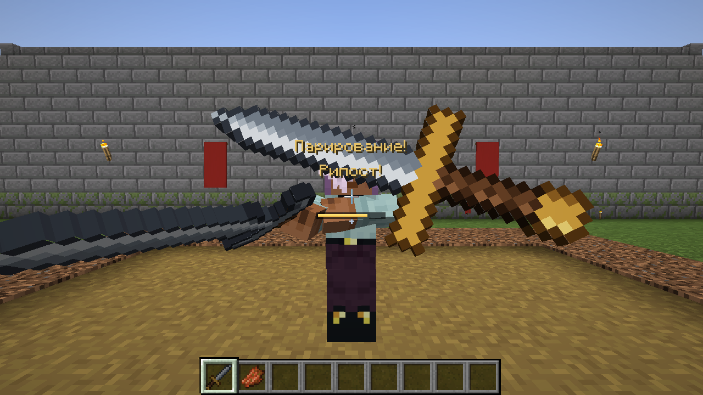

# Рыцарский бой — мод для Minecraft Forge 1.20.1

Ближний бой в духе Chivalry 2: удары с направлением (сбоку, сверху, укол) с замахом, ударом и восстановлением,
комбо, финты, блок и парирование, рипост, контратака, пинок, выносливость и боевой клич.
Девять видов средневекового оружия, а мечи и топоры из Minecraft тоже дерутся по новым правилам.

- **Minecraft** 1.20.1, **Forge** 47.4.28 (подходит любой Forge 47.x)
- **ID мода:** `knightcombat`
- Работает в одиночной игре и на сервере. Мод нужен и серверу, и всем игрокам: правила боя считает сервер,
  клиент отправляет нажатия и рисует анимации.

| Противник замахивается | Парирование |
|------------------------|-------------|
|  |  |
| **Удар сбоку от первого лица** | **Удар сверху против блока алебардой** |
|  |  |
| **Девять видов оружия** | **Подсказка оружия** |
|  |  |

## Управление

| Действие | Кнопка | Как работает |
|----------|--------|--------------|
| Удар сбоку | ЛКМ | Горизонтальный удар. Нажатие во время удара — комбо: следующий удар идёт в обратную сторону и с более коротким замахом |
| Удар сверху | колесо вверх или **R** | Медленнее, но сильнее |
| Укол | колесо вниз или **Z** | Быстрый и с самой большой дальностью |
| Блок | ПКМ (удерживать) | Первые 0,3 секунды блока — **парирование** |
| Финт | **G** | Отменить замах, чтобы обмануть противника |
| Пинок | **V** | Выбивает противника из блока |
| Боевой клич | **B** | Восстанавливает часть выносливости |
| Ломать блоки оружием | Shift + ЛКМ | Пока прицел на блоке и рядом нет врагов, ЛКМ и так ломает блоки |

Кнопки меняются в настройках управления (раздел «Рыцарский бой»). Если колесо мыши нужно для смены
слота, атаки колесом выключаются в `config/knightcombat-client.toml`.
ПКМ по двери, сундуку, жителю, лошади и т. п. работает как обычно: блок оружием ставится, когда прицел
на противнике (монстре или игроке) или ни на что не наведён. Лодки, вагонетки и рамки ломаются обычным ударом.
В подсказке к оружию с зажатым Shift видно управление.

## Как устроен бой

### Удар: замах, удар, восстановление
Каждый удар проходит три фазы:
1. **Замах** — противник видит, какой удар готовится. Во время замаха можно сделать финт или сменить
   удар (например, начать удар сбоку и превратить его в укол).
2. **Удар** — оружие движется по дуге, и всё, что оно задевает, получает урон. Удар сбоку проходит
   справа налево (в комбо — обратно), удар сверху — от головы вниз, укол — вперёд.
   Попадание считается по настоящей траектории клинка, поэтому важно, куда смотрит атакующий во время удара.
3. **Восстановление** — короткая пауза. Нажатие атаки во время удара или в начале восстановления запускает комбо.

Удар, попавший в стену, отскакивает: в узком коридоре удар сбоку бьёт о стены, лучше колоть или бить сверху.

### Защита
- **Блок** (ПКМ) отражает удары спереди и тратит выносливость. Пока держите блок, вы двигаетесь медленнее
  и выносливость не восстанавливается.
- **Парирование** — блок, поставленный перед самым ударом (в первые 0,3 секунды). Тратит вдвое меньше
  выносливости, а атакующий надолго «отскакивает» и не может сразу ударить снова.
- **Рипост** — атака сразу после парирования: замах намного короче, и до удара вы прикрыты, как блоком.
- **Контратака** — начать тот же удар, что летит в вас (сбоку против удара сбоку и т. д.), в самый последний
  момент. Ваш замах отражает вражеский удар и превращается в быстрый рипост.
- **Пинок** пробивает блок: противник теряет выносливость и на мгновение не может ничего делать.
- **Щит** в другой руке работает как обычный щит Minecraft и тоже тратит выносливость. Топоры и молоты выбивают щиты.
- Блок оружием отражает и удары мобов, и стрелы. Парирование отбрасывает моба.

### Выносливость
Шкала под прицелом. Её тратят блоки, финты, смена удара, пинки и промахи. Через секунду без трат
выносливость начинает восстанавливаться. Если блок принимает удар, когда выносливость на нуле, **защита пробита**:
вы на секунду открыты.

### Сбитый замах
Любое попадание по вам во время замаха (кроме рипоста) сбивает его. Поэтому быстрое оружие
наказывает медленные замахи, а удар, начатый первым, не всегда успевает первым.

### Боевой клич
Поднимает оружие над головой, восстанавливает 35 выносливости. Перезарядка — 20 секунд.

## Оружие

| Оружие | Хват | Сбоку / сверху / укол (урон) | Замах сбоку | Дальность | Особенности |
|--------|------|------------------------------|-------------|-----------|-------------|
| Кинжал | одноручное | 5 / 6 / 6 | 0,25 с | 2,5 | самый быстрый, слабый блок |
| Фальшион | одноручное | 7 / 8 / 6 | 0,35 с | 2,8 | быстрый и надёжный |
| Моргенштерн | одноручное | 8 / 10 / 5 | 0,45 с | 2,9 | дробящее: пробивает броню |
| Длинный меч | двуручное | 8 / 10 / 8 | 0,40 с | 3,1 | лучший блок, ровный во всём |
| Цвайхендер | двуручное | 11 / 13 / 10 | 0,55 с | 3,6 | длинный и тяжёлый |
| Боевой топор | двуручное | 10 / 12 / 6 | 0,50 с | 3,0 | сильные удары, выбивает щиты |
| Боевой молот | двуручное | 9 / 14 / 7 | 0,60 с | 3,2 | дробящее, мощный удар сверху, выбивает щиты |
| Алебарда | древковое | 10 / 13 / 9 | 0,60 с | 3,9 | большая дальность, выбивает щиты |
| Копьё | древковое | 6 / 8 / 9 | 0,50 с | 4,2 | самый длинный укол |

Урон указан без зачарований; «Острота», «Небесная кара», «Бич членистоногих», «Заговор огня», «Отдача»
и «Добыча» работают как обычно. Удары тяжёлого оружия сильнее отнимают выносливость у того, кто их блокирует.

### Рецепты
| Оружие | Рецепт (верстак) |
|--------|------------------|
| Кинжал | железный слиток над кожей |
| Фальшион | `_ЖЖ` / `_Ж_` / `К__` — Ж железный слиток, К кожа |
| Длинный меч | `__Ж` / `ЗЖ_` / `КЗ_` — З золотой слиток |
| Цвайхендер | `__Ж` / `ЖБ_` / `КЖ_` — Б железный блок |
| Боевой топор | `ЖЖЖ` / `ЖП_` / `_П_` — П палка |
| Моргенштерн | `СЖС` / `_П_` / `_К_` — С железный самородок |
| Боевой молот | `ЖБЖ` / `_П_` / `_П_` |
| Алебарда | `_ЖЖ` / `_ПЖ` / `П__` |
| Копьё | `__Ж` / `_П_` / `П__` |

Всё оружие есть в творческой вкладке «Рыцарский бой», чинится железными слитками на наковальне.

### Оружие из Minecraft и других модов
Мечи и топоры (в том числе из других модов, если они сделаны как мечи и топоры Minecraft) тоже дерутся
ударами с замахом и блоком. Их урон берётся из самого предмета. Это выключается настройкой `vanillaWeapons`.

## Настройки

Сервер — `serverconfig/knightcombat-server.toml` в папке мира:

| Параметр | По умолчанию | Описание |
|----------|--------------|----------|
| `vanillaWeapons` | true | Мечи и топоры Minecraft тоже дерутся по правилам мода |
| `wallsStopAttacks` | true | Стены останавливают удары |
| `maxStamina` | 100 | Запас выносливости |
| `staminaRegenPerSecond` | 25 | Восстановление выносливости в секунду |
| `damageMultiplier` | 1.0 | Множитель всего урона оружием |
| `battleCryCooldownSeconds` | 20 | Перезарядка боевого клича |

Клиент — `config/knightcombat-client.toml`: атаки колесом мыши (`scrollAttacks`), покачивание камеры
при ударах (`cameraSway`), шкала выносливости (`staminaBar`) и сообщения у прицела (`hitMessages`).

## Сборка

Мод собирается вместе с остальными модами репозитория (см. [README в корне](../README.md)):

| Команда | Что делает |
|---------|-----------|
| `./gradlew :knightcombat:build` | Собирает мод в `knightcombat/build/libs/knightcombat-1.0.0.jar` и запускает тесты |
| `./gradlew :knightcombat:runClient` | Запускает Minecraft с модом |
| `./gradlew :knightcombat:runServer` | Запускает выделенный сервер с модом |

## Устройство проекта

```
src/main/java/io/github/nicksementsov/knightcombat/
  KnightCombat.java, CombatConfig.java   главный класс мода и настройки
  combat/       правила боя на сервере: фазы ударов, блоки, парирования, выносливость,
                траектории клинка и попадания, характеристики оружия
  item/         предмет оружия
  network/      пакеты: нажатия игрока, состояние бойца для анимаций, выносливость, события боя
  registry/     регистрация предметов, звуков и творческой вкладки
  client/       управление, анимации от первого и третьего лица, камера, шкала выносливости, подсказки
src/main/resources/
  assets/knightcombat/   текстуры, модели предметов, звуки, переводы (ru_ru, en_us)
  data/                  рецепты
src/test/java/          тесты геометрии ударов и математики поз
tools/generate_assets.py   генератор текстур оружия, моделей, sounds.json и рецептов
```

### Как сделаны анимации
Позы задаются направлениями: куда смотрит рука, куда направлен клинок и куда повернута его плоская сторона.
От третьего лица мод сам ставит руки модели игрока (через позу руки Forge) и сам рисует оружие в руке, поэтому
клинок может быть повернут как угодно. Двуручное оружие держится двумя руками: вторая рука тянется к рукояти.
От первого лица оружие рисуется в своей позе для каждой фазы, камера слегка следует за ударом.

### Текстуры и звуки
Текстуры оружия рисует скрипт (пиксель-арт по диагонали, как у мечей Minecraft):

```bash
pip install pillow numpy
python3 knightcombat/tools/generate_assets.py
```

Звуки — это звуки самого Minecraft (звон наковальни, удары, щит, клич разбойника) с другой высотой и громкостью,
собранные в `sounds.json`. Из Chivalry 2 взяты только идеи механик, графики и звуков игры в моде нет.
